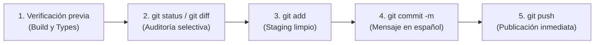

# 🚀 Flujo de Trabajo Git y Convenciones de Versionado

> **Estándar Canónico de Control de Versiones, Conventional Commits y Despliegue Continuo**  
> *Lectura obligatoria para colaboradores humanos y agentes autónomos de IA en Kumbia Sound.*

---

## 1. 🔄 El Ciclo de Trabajo Obligatorio

En este proyecto, cada modificación completada debe cerrarse de inmediato siguiendo este ciclo continuo:



### Pasos Operativos:
1. **Verificación previa:** Asegurar que el proyecto compila y no hay errores de tipos:
   ```bash
   npx tsc --noEmit
   npm run build
   ```
2. **Auditoría selectiva de cambios:**
   ```bash
   git status
   git diff
   ```
3. **Staging selectivo:** Agregar únicamente los archivos correspondientes a la tarea (evitar `git add .` indiscriminado):
   ```bash
   git add <archivo_1> <archivo_2>
   ```
4. **Commit con mensaje convencional en español:**
   ```bash
   git commit -m "<tipo>: <descripción clara en presente o infinitivo>"
   ```
5. **Push remoto inmediato:**
   ```bash
   git push origin <rama-actual>
   ```

---

## 2. 📝 Convención de Commits (Conventional Commits)

Todos los mensajes de commit deben redactarse en **español**, en modo indicativo presente o infinitivo, y sin punto final en la primera línea.

### Estructura Canónica:
```text
<tipo>(<alcance_opcional>): <descripción concisa (máximo 72 caracteres)>

[cuerpo explicativo opcional: justificación y detalles relevantes]

[pie de commit opcional: referencias a issues, breaking changes, etc.]
```

### Tipos Permitidos:

| Prefijo | Cuándo Usarlo | Ejemplo Práctico |
| :--- | :--- | :--- |
| **`feat:`** | Nueva característica, módulo, vista o tabla en la aplicación. | `feat: agregar panel de administración para subida de fotos WebP` |
| **`fix:`** | Corrección de un error funcional, fallo de cálculo o bug visual. | `fix: corregir cálculo de duración en segundos para pistas de vinilo` |
| **`docs:`** | Creación o actualización de documentación en `docs/` o `README.md`. | `docs: reestructurar documentacion bajo estandar docs-as-code` |
| **`refactor:`** | Modificación interna del código que no añade features ni corrige bugs. | `refactor: paralelizar consultas en Server Components con Promise.all` |
| **`style:`** | Ajustes visuales, diseño CSS, Tailwind o formateo sin cambios de lógica. | `style: aplicar estética brutalista a tarjetas de catálogo` |
| **`test:`** | Adición o corrección de pruebas automatizadas. | `test: agregar prueba de integridad para función recursiva RPC` |
| **`chore:`** | Tareas auxiliares, actualización de dependencias, scripts o `.gitignore`. | `chore: actualizar dependencias y scripts de skills en package.json` |

---

## 3. 🛡️ Buenas Prácticas y Prohibiciones Estrictas

1. **Prohibido el `git add .` Ciego:** Revisa siempre con `git status` qué archivos vas a incluir para evitar subir archivos de entorno (`.env`), temporales (`.temp/`) o ejecutables.
2. **Prohibido Commitear Secretos:** Nunca confirmes contraseñas, URLs con tokens de servicio ni llaves privadas de Supabase en archivos versionados.
3. **Commits Atómicos:** Cada commit debe representar un cambio lógico único. No mezcles una refactorización de base de datos con un cambio cosmético de CSS.
4. **Respetar el Protocolo de Documentación Viva:** Si el cambio altera una función, ruta o regla de negocio, el archivo de documentación correspondiente en `docs/` debe actualizarse en ese mismo commit.
