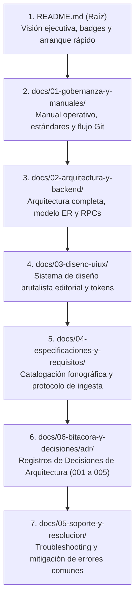

# 🤖 Manual Operativo del Proyecto para Agentes de IA y Desarrolladores (Kumbia Sound)

> **Guía Maestra de Arranque, Contexto Arquitectónico, Gobernanza Técnica y Estándar Docs-as-Code**  
> *Lectura prioritaria y obligatoria para cualquier agente autónomo o ingeniero que deba inicializar, auditar, refactorizar o extender el repositorio de Kumbia Sound.*

---

## 1. 🎯 Contexto Rápido del Proyecto y Cambios Recientes

**Kumbia Sound** es una plataforma web especializada en la preservación fonográfica, genealogía musical y análisis técnico (BPM / Camelot) de la cumbia grabada en el Perú durante su etapa de oro y evolución (**1968–2005**).

### ⚡ Resumen de Decisiones e Implementaciones Consolidadas
Cualquier desarrollador o agente que trabaje sobre este repositorio debe tener presentes las siguientes decisiones estructurales:

1. **Reorganización Estándar POSIX y Docs-as-Code:**
   Toda la documentación técnica del proyecto reside estrictamente bajo `docs/` en carpetas numeradas temáticas. La raíz del proyecto únicamente aloja el archivo [`README.md`](../../README.md).
2. **Soporte Físico Estricto a Lados A y B:**
   En los soportes de la época (45 RPM, LPs y Casetes), únicamente existen **Lado A** y **Lado B**. Está formalmente prohibido introducir Lados C o D en cualquier tabla, validación o componente.
3. **Seudónimos y Créditos de Galleta ("Piratería Blanca"):**
   Se implementó la columna opcional `credito_como TEXT NULL` en `Tema_Musicos` y `Temas_Compositores` para reflejar nombres ficticios usados para eludir contratos de exclusividad disquera, manteniendo la clave foránea vinculada a la persona real en `Personas`.
4. **Mosaicos, Popurrís y Enganchados:**
   Se mantiene el surco físico continuo en `Albumes_Temas` (`es_mosaico = TRUE`) y se desglosan las obras individuales en la tabla intermedia `Mosaicos_Temas` (`orden_segmento`, `duracion_segmento_segundos`), protegiendo la autoría y las métricas armónicas.
5. **Procedimientos Almacenados en PostgreSQL (RPC):**
   * `get_arbol_genealogico(p_persona_id INT)`: Retorna un objeto JSON con la biografía, bandas como director o integrante de planta, sesiones instrumentales y canciones compuestas.
   * `get_genealogia_versiones(p_tema_id INT)`: Resuelve el árbol completo de covers mediante `WITH RECURSIVE`, con ascenso a la raíz original y descenso con prevención matemática de ciclos (`camino || v.id_tema`).
6. **Segregación de Servicios Supabase en Next.js:**
   * Navegador: [`genealogia-service.ts`](../../src/features/genealogia/services/genealogia-service.ts) usa `@/lib/supabase/client`.
   * Servidor: [`genealogia-service.server.ts`](../../src/features/genealogia/services/genealogia-service.server.ts) usa `@/lib/supabase/server`.
   * *Prohibido importar `@/lib/supabase/server` en archivos con `'use client'`.*
7. **Pipeline Multimedia WebP en Cliente (`/admin`):**
   El componente `ImageUploader` intercepta JPG/PNG y los convierte a WebP (calidad 0.90) mediante HTML5 Canvas API antes de subirlos a Supabase Storage.
8. **SEO Patrimonial (Schema.org / JSON-LD):**
   Inyección de metadatos estructurados para `MusicAlbum`, `MusicRecording`, `MusicGroup`, `Person` y `RecordLabel` en Server Components ([`src/app/album/[id]/page.tsx`](../../src/app/album/[id]/page.tsx)).
9. **Subpágina `/vinilos` y Optimización Vercel / React Best Practices:**
   Filtros fonográficos interactivos, orden analógico de temas A1..An / B1..Bn, paralelización de consultas independientes con `Promise.all()`, deduplicación por ciclo de petición en servidor con `React.cache()` y code-splitting de modales mediante `next/dynamic`.

---

## 2. 📜 Protocolo de Documentación Viva (Living Docs)

> [!IMPORTANT]
> ### Regla de Documentación Continua
> **Cada vez que se introduzca un cambio de código, se altere una pantalla, se modifique una API, se agregue una skill o se tome una nueva decisión técnica, es MANDATORIO actualizar inmediatamente el archivo `.md` correspondiente en `docs/` en el mismo ciclo de trabajo para erradicar la obsolescencia técnica.**
>
> Ningún Pull Request o commit de feature/fix se considera terminado si genera discrepancias con los manuales o esquemas documentados.

---

## 3. 📖 Secuencia Mandatoria de Lectura Documental

Para construir un modelo mental coherente antes de escribir o modificar código, la secuencia de lectura obligatoria es:



---

## 4. 🏗️ Layout Canónico del Repositorio (Estructura Docs-as-Code)

Todo el proyecto se rige por la siguiente distribución modular:

```text
cumbia-peruana/
├── docs/                                      # Hogar canónico de la documentación
│   ├── 01-gobernanza-y-manuales/              # Gobernanza, manuales de desarrollo y reglas IA
│   │   ├── manual-operativo-proyecto.md       # Este documento (visión general y arranque)
│   │   ├── lineamientos-desarrollo-codigo.md  # Estándares TypeScript, Next.js y componentes
│   │   ├── flujo-git-y-convenciones.md        # Ciclo Git y Conventional Commits
│   │   ├── reglas-agentes-ia.md               # Directivas e instrucciones para agentes
│   │   ├── catalogo-skills-ia.md              # Catálogo de las 28 skills instaladas
│   │   └── guia-documentacion-proyectos.md    # Metodología Docs-as-Code para otros catálogos
│   ├── 02-arquitectura-y-backend/             # Arquitectura del sistema, capas y BD
│   │   ├── arquitectura-sistema-y-datos.md    # Diagramas de capas, modelo ER y RPCs
│   │   └── sql-referencia/                    # DDL estructural de referencia
│   ├── 03-diseno-uiux/                        # Sistema de diseño e identidad visual
│   │   └── sistema-diseno-brutalista.md       # Filosofía pericial, tokens CSS y componentes
│   ├── 04-especificaciones-y-requisitos/      # Reglas del dominio e investigación
│   │   ├── manual-catalogacion-e-ingesta.md   # Protocolo de catalogación fonográfica e ingesta
│   │   └── datos-investigacion/               # Hojas tabulares maestras (Datos BD.ods)
│   ├── 05-soporte-y-resolucion/               # Resolución de incidentes y problemas
│   │   └── guia-resolucion-problemas.md       # Troubleshooting de Next.js, Supabase y datos
│   └── 06-bitacora-y-decisiones/              # Historial de decisiones arquitectónicas
│       └── adr/                               # Architecture Decision Records (001 al 005)
├── public/                                    # Activos estáticos públicos
│   ├── branding/                              # Logotipos e isotipos institucionales
│   └── images/                                # Fondos hero y fotografías de archivo
├── scripts/                                   # Scripts de automatización e ingesta
│   └── poblar-db.mjs                          # Poblado idempotente hacia Supabase Data API
├── src/                                       # Código fuente de Next.js App Router
│   ├── app/                                   # Rutas, layouts y páginas
│   ├── components/                            # Componentes transversales y SEO JSON-LD
│   ├── features/                              # Módulos orientados al dominio (Feature-Driven)
│   ├── lib/                                   # Clientes de infraestructura Supabase
│   └── types/                                 # Interfaces TypeScript y tipos de BD
├── supabase/                                  # Infraestructura de base de datos
│   ├── data/                                  # Sentencias de inserción histórica SQL
│   └── migrations/                            # Migraciones versionadas DDL y RLS
├── .env.example                               # Plantilla de variables de entorno
├── next.config.ts                             # Configuración de Next.js
├── package.json                               # Dependencias y scripts de npm
└── README.md                                  # Único archivo Markdown en la raíz del proyecto
```

---

## 5. 🛠️ Guía de Arranque y Puesta en Marcha

### Paso 1: Dependencias y Restauración de Skills
```bash
git clone https://github.com/JorgeJordyJaimes/cumbia-peruana.git
cd cumbia-peruana
npm install
npm run skills:install
```

### Paso 2: Variables de Entorno
Copia la plantilla y configura tus credenciales locales:
```bash
cp .env.example .env.local
```
Variables obligatorias:
* `NEXT_PUBLIC_SUPABASE_URL`: Endpoint de tu instancia Supabase.
* `NEXT_PUBLIC_SUPABASE_ANON_KEY`: Llave pública anónima de Supabase.

### Paso 3: Poblado del Catálogo Histórico
```bash
npm run db:poblar
```

### Paso 4: Verificación y Ejecución
```bash
npx tsc --noEmit
npm run lint
npm run build
npm run dev
```
La aplicación iniciará en `http://localhost:3000`.

---

## 6. ⚠️ Reglas Inmutables y Restricciones del Dominio

| Regla Inmutable | Explicación Técnica y Razón de Ser |
| :--- | :--- |
| **Exclusividad de Lados A y B** | No inventar ni admitir Lados C o D en el período 1968–2005. Toda tabla física valida `CHECK (lado IN ('A', 'B'))`. |
| **Duración Siempre en Segundos** | En SQL y base de datos, toda duración se almacena como número entero de segundos (`duracion_segundos`). Prohibido insertar strings con formato `MM:SS`. |
| **Camelot Exclusivo** | Solo se admite notación Camelot (`camelot_code` tipo `1A` a `12B`). La notación clásica del círculo de quintas está descartada. |
| **Convención Booleana Vacío = NO** | En las hojas de datos (`Datos BD.ods`), celda vacía significa `FALSE`. Solo se escribe `SI` para `TRUE`. |
| **Separación Letra / Nota Agente / Comentario** | `LETRA DEL TEMA` va a `letra TEXT`, `NOTA PARA EL AGENTE` es solo para instrucciones internas (mosaicos, covers), y `COMENTARIOS / NOTAS` va a la base de datos. |
| **Data API Grants Obligatorios** | Toda nueva tabla o función RPC debe tener sentencias `GRANT ... TO anon, authenticated, service_role` y RLS habilitado. |
| **No Mezclar Clientes Supabase** | Nunca importar `@/lib/supabase/server` en archivos con `'use client'`. |
| **No Pistas Falsas para Mosaicos** | Nunca fragmentar un surco físico de vinilo en pistas artificiales (ej. 3a, 3b). Usa `Mosaicos_Temas` con `es_mosaico = TRUE`. |
| **Preservar Identidad en Seudónimos** | Nunca crear una persona ficticia en `Personas` si se conoce la identidad del músico; usa `credito_como` en `Tema_Musicos` o `Temas_Compositores`. |
| **Solo WebP en Supabase Storage** | Nunca subir JPG o PNG directo al bucket; procesar siempre mediante el pipeline Canvas WebP en el navegador. |
| **Rendimiento y Cache en Servidor** | En Server Components, paralelizar siempre con `Promise.all()` las consultas independientes y envolver en `React.cache()` las funciones compartidas con `generateMetadata`. Cargar modales mediante `next/dynamic`. |
| **Commits en Español** | Conventional Commits estrictamente en español (`feat:`, `fix:`, `docs:`, `refactor:`, `style:`). |
