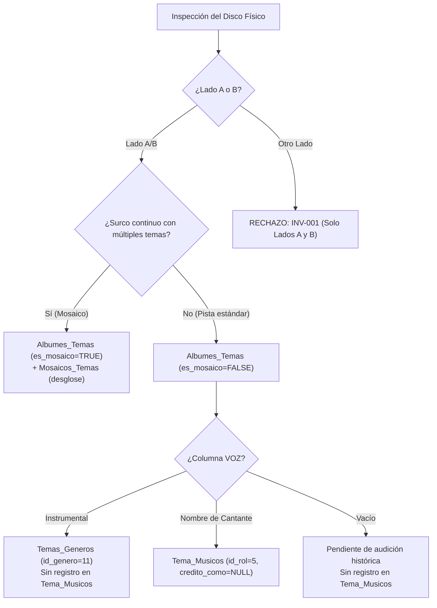

# Dominio Fonográfico e Invariantes del Proyecto

> **Propósito:** Especificar las invariantes inviolables, reglas musicológicas y conocimientos expertos que rigen la catalogación y modelado de la cumbia peruana en Kumbia Sound.
> **Responde a:** ¿Cuáles son las reglas no negociables de la fonografía peruana (1968–2005)? ¿Cómo se resuelven casos difíciles como seudónimos, mosaicos y discos split? ¿Qué consecuencias acarrea violar cada invariante?
> **Fuente principal de:** Invariantes `INV-NNN`, reglas del soporte físico analógico y directivas de resolución fonográfica.
> **No contiene (ver):** Definiciones de vocabulario → [glosario.md](glosario.md); esquema técnico de base de datos → [../03-arquitectura/modelo-de-datos.md](../03-arquitectura/modelo-de-datos.md); reglas operativas de IA → [../../AGENTS.md](../../AGENTS.md).
> **Depende de:** [glosario.md](glosario.md), [presentacion.md](presentacion.md).
> **Entregar a otra IA para:** Auditoría de integridad de base de datos, generación de scripts de ingesta fonográfica y resolución de discrepancias discográficas.
> **Estado:** VIGENTE · **Última revisión:** 2026-10-31 · **Describe la versión:** 0.1.0 / commit 04ef58c

---

## 1. Invariantes Inviolables del Dominio (`INV-NNN`)

Las siguientes invariantes son **leyes del sistema**. No pueden alterarse bajo ninguna circunstancia, refactorización o propuesta de diseño:

### INV-001 · Exclusividad Estricta de Lados A y B (1968–2005)
* **Regla:** En el archivo histórico de vinilos (45 RPM singles, LPs, EPs) y cintas de casete de cumbia peruana únicamente existen **Lado A** y **Lado B**.
* **Por qué existe:** La tecnología física analógica comercial en el Perú de ese período se limitaba exclusivamente a prensajes de dos caras.
* **Qué datos protege:** La veracidad fonográfica y la integridad del catálogo físico.
* **Cómo se comprueba:** Restricción DDL en PostgreSQL: `CONSTRAINT chk_albumes_temas_lados_ab CHECK (lado IS NULL OR lado IN ('A', 'B'))`.
* **Consecuencia de violarla:** Rechazo inmediato en base de datos (`HTTP 400 / SQL Error`). Queda terminantemente prohibido introducir o mapear Lados C, D o ficticios.

### INV-002 · Duración Exclusiva en Segundos Totales Enteros
* **Regla:** Toda duración de tema o segmento se almacena estrictamente como un **número entero de segundos** (`duracion_segundos INT`).
* **Por qué existe:** Permite ordenamiento aritmético, sumatorias precisas de duración por lado de vinilo y cálculos de reproducción en interfaces.
* **Qué datos protege:** Columnas `duracion_segundos` en `Temas` y `duracion_segmento_segundos` en `Mosaicos_Temas`.
* **Cómo se comprueba:** Tipado entero `INT` en BD y validación Zod en esquemas.
* **Consecuencia de violarla:** Error de tipo en SQL si se intenta insertar una cadena tipo `'03:15'`. La conversión matemática mandatoria es:
  $$\text{duracion\_segundos} = (\text{minutos} \times 60) + \text{segundos}$$

### INV-003 · Notación Camelot Key Exclusiva (Sin Círculo de Quintas Clásico)
* **Regla:** La tonalidad armónica se gestiona única y exclusivamente mediante el código alfanumérico **Camelot Key** (`camelot_code VARCHAR(10)`, valores de `1A` a `12B`).
* **Por qué existe:** Estandariza la indexación armónica para DJs y selectores, descartando la ambigüedad de la notación clásica (`Am`, `La menor`, `C#m`).
* **Qué datos protege:** Atributo `camelot_code` en la tabla `Temas`.
* **Cómo se comprueba:** Validación por expresión regular `^0?([1-9]|1[0-2])[AB]$` normalizada a sin ceros a la izquierda (ej. `9B`, no `09B`). La columna legacy `musical_key` fue eliminada del esquema.
* **Consecuencia de violarla:** Errores de concordancia en el motor de `/match-bpm` y degradación de la experiencia DJ.

### INV-004 · Convención Booleana: `SI` = `TRUE` / Celda Vacía = `FALSE`
* **Regla:** En las hojas de catalogación (`Datos BD.ods`), una celda con el texto `SI` o `SÍ` equivale a `TRUE`. Cualquier celda vacía o en blanco se mapea estrictamente a `FALSE`.
* **Por qué existe:** Elimina la ambigüedad en columnas booleanas (`es_recopilatorio`, `es_mosaico`, `es_grabacion_inedita`, `es_disco_split`).
* **Qué datos protege:** Integridad de flags booleanos con `DEFAULT FALSE` en PostgreSQL.
* **Cómo se comprueba:** Parser algorítmico en scripts de ingesta (`scripts/poblar-db.mjs`).
* **Consecuencia de violarla:** Celdas vacías mapeadas indebidamente a `NULL` violarían restricciones de no nulidad.

### INV-005 · Separación Estricta de Columnas Finales en Temas
* **Regla:** En las hojas de trabajo existen tres columnas finales con propósitos disjuntos:
  1. `LETRA DEL TEMA`: Va directamente a `Temas.letra TEXT`.
  2. `NOTA PARA EL AGENTE`: **Canal interno de catalogador a IA**. Contiene instrucciones relacionales (desglose de mosaicos, títulos para enlazar covers). **Nunca se inserta como texto en la base de datos**.
  3. `COMENTARIOS / NOTAS`: Observaciones históricas y musicológicas que van a `Albumes.comentario` o notas públicas.
* **Por qué existe:** Evita la polución de la base de datos con comentarios meta-operativos.
* **Qué datos protege:** Pureza de la columna `letra` y de las relaciones en `Mosaicos_Temas`.
* **Cómo se comprueba:** Inspección en generadores de ingesta.

### INV-006 · Prevalencia de `Datos BD.ods` y Notificación de Discrepancias
* **Regla:** La hoja de investigación [`docs/datos-investigacion/Datos BD.ods`](../datos-investigacion/Datos%20BD.ods) es la **fuente suprema de verdad**. Si un dato previo en SQL difiere de `Datos BD.ods`, prevalece la hoja tabular y es **obligatorio reportar la discrepancia al usuario**.
* **Por qué existe:** Refleja la auditoría pericial humana directa sobre el disco físico.
* **Qué datos protege:** Fidelidad histórica de todo el catálogo.
* **Cómo se comprueba:** Comparación previa a la generación de sentencias SQL.

### INV-007 · Integridad Física del Surco en Mosaicos y Popurrís
* **Regla:** Un mosaico o popurrí continuo en vinilo representa **un solo surco físico**. Queda terminantemente prohibido crear pistas artificiales (ej. 3a, 3b). El surco se registra en `Albumes_Temas` (`es_mosaico = TRUE`) y sus canciones se desglosan en `Mosaicos_Temas` (`orden_segmento`).
* **Por qué existe:** Conserva el número real de pistas físicas del LP (evita que un disco de 6 temas por lado figure falsamente con 9 pistas).
* **Qué datos protege:** Tablas `Albumes_Temas` y `Mosaicos_Temas`.
* **Cómo se comprueba:** Clave primaria compuesta `(id_album_tema, orden_segmento)`.

### INV-008 · Aislamiento Estricto de Créditos de Voz
* **Regla:** La columna `VOZ` registra exclusivamente a la persona que canta en `Tema_Musicos` (`id_rol = 5`, `instrumento = 'Voz'`). **`Tema_Musicos.credito_como` debe ser SIEMPRE `NULL`** para que la aplicación renderice directamente `personas.nombre`.
* **Prohibición crítica:** La columna `CRÉDITO EN GALLETA (SEUDÓNIMO)` pertenece exclusivamente al **compositor** (`Temas_Compositores.credito_como` y `Albumes_Temas.credito_galleta`). **Bajo ninguna circunstancia se asigna el seudónimo del compositor a los cantantes en `Tema_Musicos`**.
* **Por qué existe:** Evita que cantantes reales (ej. Chacalón, Carlos Yap) aparezcan en pantalla con el alias del compositor (ej. Víctor Casahuamán).

### INV-009 · Tratamiento de Pistas Instrumentales vs. Cantante Pendiente
* **Regla:**
  * Si la columna `VOZ` contiene **`Instrumental`**: La pista es 100% instrumental. Se asocia obligatoriamente el género `Instrumental` (`id_genero = 11`, `es_principal = FALSE`) en `Temas_Generos` y **NO se inserta ninguna fila en `Tema_Musicos`**.
  * Si la columna `VOZ` está **vacía o en blanco**: Representa un tema cantado cuyo vocalista está pendiente de investigación histórica. **NO se inserta fila en `Tema_Musicos` y NO se marca como Instrumental**.
* **Por qué existe:** Permite a los filtros de la web buscar "Solo instrumentales" con fidelidad matemática.

### INV-010 · Título Canónico de Singles de 45 RPM (`Lado A / Lado B`)
* **Regla:** Los singles de 45 RPM (`id_tipo_album = 1`) carecen de nombre comercial propio de álbum. Su título canónico se forma obligatoriamente con el título del tema del Lado A y el tema del Lado B separados por `" / "` (ej. `Viento / Te perdí`).
* **Por qué existe:** Práctica estándar de la industria discográfica analógica de 7''.
* **Cómo se comprueba:** Trigger en base de datos: `trg_sync_single_title_albumes_temas` ejecutando la función `fn_sync_single_title()`.

---

## 2. Casos Difíciles del Dominio y Resolución Canónica

### 2.1. Homónimos y Seudónimos ("Piratería Blanca")
Durante las décadas de 1970 y 1980 en Lima, un mismo compositor o guitarrista grababa para Infopesa bajo contrato formal y, simultáneamente, grababa para Discos Horóscopo o Sono Radio usando un seudónimo.
* **Resolución:**
  * En `Personas` se almacena una única entidad con el nombre legal real (ej. `Víctor Horacio Casahuamán Bendezú`).
  * En `Temas_Compositores` se vincula `id_persona` y se coloca el alias literal en `credito_como` (ej. `'Víctor Casahuamán B.'`, `'Juan de Dios'`).

### 2.2. Álbumes Compartidos (*Discos Split*)
Vinilos donde el Lado A pertenece a un grupo y el Lado B pertenece a una agrupación totalmente distinta.
* **Resolución:**
  * En `Albumes`: `es_disco_split = TRUE` y `id_grupo = NULL`.
  * En `Albumes_Grupos_Lados`: Se crea una fila por lado vinculando `(id_album, 'A', id_grupo_1)` y `(id_album, 'B', id_grupo_2)`.

---

## 3. Fuentes de Verdad del Dominio

1. **Disco físico bajo custodia:** Galletas, portadas, contraportadas y surco muerto de vinilos, casetes y CDs originales.
2. **Registro de investigación:** [`docs/datos-investigacion/Datos BD.ods`](../datos-investigacion/Datos%20BD.ods).
3. **Archivos gremiales y testimonios orales:** Registros de APDAYC, entrevistas contrastadas con fundadores y musicólogos de cumbia peruana.

---

## 4. Actualizar cuando
- Se identifique un nuevo patrón fonográfico en casetes, EPs o CDs que requiera formalizar una invariante.
- Se resuelva una disputa histórica sobre autorías o matrices de prensaje.

## 5. Pendientes
- Ninguno activo.
