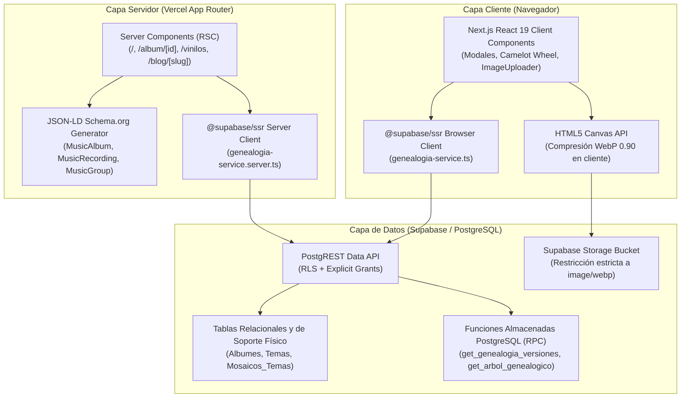
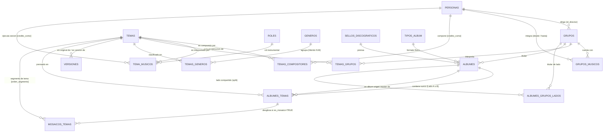

# 🏛️ Arquitectura Integral del Sistema, Modelo Fonográfico y Backend

> **Especificación Canónica de Arquitectura de Software, Modelo Relacional Fonográfico y Procedimientos Almacenados en PostgreSQL**  
> *Fusión unificada del Manifiesto Arquitectónico y la Especificación Técnica de Kumbia Sound.*

---

## 1. 🎯 Propósito y Pilares Estratégicos del Proyecto

**Kumbia Sound** es una plataforma web y archivo digital histórico, musicológico y técnico dedicado al rescate integral de la cumbia grabada en el Perú durante sus décadas formativas y de máxima evolución (**1968–2005**).

A diferencia de catálogos digitales genéricos, Kumbia Sound está concebido desde la **realidad material del soporte físico** (discos de vinilo de 45 RPM singles, álbumes LP de 33 RPM, EPs, Casetes y CDs) prensados por emblemáticas casas discográficas peruanas (*Infopesa, Discos Horóscopo, Sono Radio, El Virrey, Odeón / IEMPSA, Difa, Discope*, etc.).

### Vertientes Históricas Catalogadas:
* **Cumbia Costeña y Psicodélica (1968–1975):** Introducción de la guitarra eléctrica Fender, pedales wah-wah, eco y fuzz (*Los Destellos, Los Diablos Rojos, Los Ecos, Manzanita y su Conjunto*).
* **Cumbia Amazónica (1970–1980):** Ritmos selváticos con psicodelia loretana (*Juaneco y su Combo, Los Mirlos, Los Wembler's de Iquitos*).
* **Cumbia Andina y Chicha (1975–1990):** Fusión migrante del huayno con la guitarra eléctrica y la lírica proletaria (*Chacalón y La Nueva Crema, Los Shapis, Grupo Celeste, Grupo Maravilla, Los Ovnis, Pintura Roja*).
* **Cumbia Norteña y Orquestal (1980–2000):** Secciones de viento, metales y percusión caribeña (*Armonía 10, Agua Marina, Los Titanes*).
* **Tecnocumbia y Sanjuanera (1995–2005):** Sintetizadores digitales, cajas de ritmos y sonidos del sur y norte del país.

### Pilares Fundamentales:
1. **Preservación Patrimonial y Créditos Reales:** Rescate de autorías, directores y sesionistas frecuentemente invisibilizados por la industria.
2. **Genealogía Musical y Trazabilidad de Sesionistas:** Seguimiento de músicos que grababan para sellos rivales bajo seudónimos (`credito_como`) y árboles de versiones (*covers*).
3. **Herramientas Técnicas para DJs:** Motor de mezcla armónica con **BPM** exacto, clave tonal y notación en la **Rueda Camelot** (1A a 12B).
4. **Web Semántica y SEO Patrimonial:** Marcado Schema.org (`MusicAlbum`, `MusicRecording`, `MusicGroup`, `Person`, `RecordLabel`) inyectado en Server Components.
5. **Archivo Documental Estricto:** Preservación de metadatos periciales y arte gráfico de alta fidelidad (WebP); **sin distribución ilegal de audio**.

---

## 2. 🌐 Arquitectura de Capas de Software

El sistema opera bajo una arquitectura desacoplada de alto rendimiento sobre Next.js (Vercel) y Supabase (PostgreSQL):



---

## 3. 🗄️ Modelo Relacional Fonográfico (Diagrama Entidad-Relación)

La base de datos resuelve con precisión la realidad material del vinilo, cintas y créditos:



### Diccionario de Entidades y Reglas Físicas

#### 1. Entidades Maestras del Mundo Real
* **`Personas`:** Identidad biográfica única de músicos, directores y autores (nombre, apodo, foto, fecha y lugar de nacimiento).
* **`Grupos`:** Orquestas y agrupaciones, vinculadas a su director fundador (`id_director`) y departamento de origen.
* **`Sellos_Discograficos`:** Casas productoras y prensadoras (*Infopesa, Discos Horóscopo, Sono Radio, El Virrey*, etc.).
* **`Generos`:** Vertientes musicales estilísticas (Costeña, Amazónica, Chicha, etc.). Relación N:M mediante `Temas_Generos` con bandera `es_principal`.
* **`Tipos_Album`:** Tipologías físicas (`1` = 45 RPM Single, `2` = LP 33 RPM, `3` = EP, `4` = Casete, `5` = CD).
* **`Roles`:** Especialidades instrumentales de estudio (*Primera Guitarra, Bajo Eléctrico, Timbales, Coros, Director Musical*).

#### 2. Soporte Físico y Trazabilidad Discográfica (`Albumes`)
Representa cada objeto físico editado comercialmente:
* `id_album` (PK), `nombre_album`, `anio_lanzamiento`, `codigo_catalogo` (código de fábrica, ej. *LPS-8001*), `codigo_matriz` (estampado mecánico en el surco muerto).
* `id_tipo_album`, `id_sello`, `id_grupo` (grupo titular o null si es compilado multiorquesta).
* `foto_portada`, `foto_contraportada`, `foto_galleta_a`, `foto_galleta_b` (rutas relativas WebP en storage).
* **Títulos de Singles:** En singles de 45 RPM (`id_tipo_album = 1`), el título se sincroniza automáticamente como `"Lado A / Lado B"` mediante la función y triggers `fn_sync_single_title`.

#### 3. Pistas Físicas y Surcos de Vinilo (`Albumes_Temas`)
Representa cada surco continuo grabado en el disco:
* `id_album_tema` (PK), `id_album`, `id_tema`, `numero_pista`.
* `lado`: Restricción física estricta mediante `CHECK (lado IN ('A', 'B'))`. **Lados C y D prohibidos.**
* `es_mosaico`: Bandera booleana. Si es `TRUE`, el surco es un enganchado/popurrí continuo desglosado en `Mosaicos_Temas`.
* `id_album_origen`: Clave foránea reflexiva hacia `Albumes`. Permite rastrear la cinta máster o prensaje original cuando un tema se reedita en álbumes recopilatorios.
* `credito_galleta`: Seudónimo o texto literal impreso en la galleta central del vinilo.

#### 4. Obras Musicales Abstractas (`Temas`)
Entidad intelectual y técnica independiente del prensaje:
* `id_tema` (PK), `nombre_tema`, `duracion_segundos` (entero obligatorio).
* `bpm` (tempo analizado) y `camelot_code` (código armónico Camelot tipo `1A` a `12B`).
* `letra`: Texto lírico de la canción.

#### 5. Mosaicos y Enganchados (`Mosaicos_Temas`)
Resuelve el problema fonográfico de los popurrís continuos en vinilo:
* Relaciona `id_album_tema` (el surco físico) con múltiples `id_tema` (las canciones individuales que lo integran).
* Columnas: `orden_segmento` (1, 2, 3...) y `duracion_segmento_segundos`.
* Preserva la autoría individual de cada composición sin falsear el conteo de pistas físicas del LP.

---

## 4. ⚙️ Procedimientos Almacenados en PostgreSQL (RPC)

Para resolver grafos complejos sin sobrecargar el ancho de banda con peticiones N+1:

### A. Árbol Genealógico Integral (`get_arbol_genealogico`)
```sql
CREATE OR REPLACE FUNCTION get_arbol_genealogico(p_persona_id INT)
RETURNS JSON AS $$
DECLARE
    v_resultado JSON;
BEGIN
    SELECT json_build_object(
        'persona', (SELECT row_to_json(p) FROM (SELECT id_persona, nombre, alias, foto_url FROM Personas WHERE id_persona = p_persona_id) p),
        'bandas_fundadas', COALESCE((SELECT json_agg(g) FROM (SELECT id_grupo, nombre_grupo FROM Grupos WHERE id_director = p_persona_id) g), '[]'::json),
        'orquestas_integradas', COALESCE((SELECT json_agg(i) FROM (
            SELECT g.id_grupo, g.nombre_grupo, r.nombre_rol, gm.anio_inicio, gm.anio_fin 
            FROM Grupos_Musicos gm 
            JOIN Grupos g ON gm.id_grupo = g.id_grupo 
            JOIN Roles r ON gm.id_rol = r.id_rol 
            WHERE gm.id_persona = p_persona_id
        ) i), '[]'::json),
        'sesiones_estudio', COALESCE((SELECT json_agg(s) FROM (
            SELECT t.id_tema, t.nombre_tema, tm.instrumento, tm.credito_como 
            FROM Tema_Musicos tm 
            JOIN Temas t ON tm.id_tema = t.id_tema 
            WHERE tm.id_musico = p_persona_id
        ) s), '[]'::json),
        'composiciones', COALESCE((SELECT json_agg(c) FROM (
            SELECT t.id_tema, t.nombre_tema, tc.credito_como 
            FROM Temas_Compositores tc 
            JOIN Temas t ON tc.id_tema = t.id_tema 
            WHERE tc.id_compositor = p_persona_id
        ) c), '[]'::json)
    ) INTO v_resultado;
    RETURN v_resultado;
END;
$$ LANGUAGE plpgsql STABLE;
```

### B. Genealogía Recursiva de Versiones (`get_genealogia_versiones`)
Implementa `WITH RECURSIVE` para ascender hasta la obra máster original y luego descender a todas las regrabaciones y covers, evitando matemáticamente ciclos infinitos:

```sql
CREATE OR REPLACE FUNCTION get_genealogia_versiones(p_tema_id INT)
RETURNS TABLE (
    id_tema INT,
    nombre_tema TEXT,
    id_tema_original INT,
    es_raiz BOOLEAN,
    nivel INT,
    camino INT[]
) AS $$
WITH RECURSIVE ArbolVersiones AS (
    -- 1. Caso Base: Encontrar la raíz original navegando ascendentemente
    SELECT t.id_tema, t.nombre_tema, t.id_tema_original, 
           (t.id_tema_original IS NULL) AS es_raiz, 
           0 AS nivel, 
           ARRAY[t.id_tema] AS camino
    FROM Temas t
    WHERE t.id_tema = (
        -- Subconsulta para ubicar el tema raíz original
        WITH RECURSIVE Raiz AS (
            SELECT id_tema, id_tema_original FROM Temas WHERE id_tema = p_tema_id
            UNION ALL
            SELECT t.id_tema, t.id_tema_original FROM Temas t JOIN Raiz r ON t.id_tema = r.id_tema_original
        )
        SELECT id_tema FROM Raiz WHERE id_tema_original IS NULL LIMIT 1
    )
    UNION ALL
    -- 2. Caso Recursivo: Descender por todas las versiones derivadas
    SELECT v.id_tema, v.nombre_tema, v.id_tema_original, 
           FALSE AS es_raiz, 
           av.nivel + 1, 
           av.camino || v.id_tema
    FROM Temas v
    JOIN ArbolVersiones av ON v.id_tema_original = av.id_tema
    WHERE NOT (v.id_tema = ANY(av.camino)) -- Prevención matemática de bucles cíclicos
)
SELECT * FROM ArbolVersiones ORDER BY nivel ASC, id_tema ASC;
$$ LANGUAGE sql STABLE;
```

---

## 5. 🖼️ Pipeline Multimedia WebP en Cliente (`Canvas API`)

Para cumplir con la política de costo cero y almacenamiento eficiente en Supabase Storage:
1. El usuario selecciona un archivo JPG o PNG en el panel `/admin`.
2. El componente `ImageUploader` intercepta el evento antes de cualquier transmisión de red.
3. Mediante un canvas HTML5 en memoria, se redimensiona proporcionalmente la imagen si supera los 1600 px y se renderiza con `toBlob('image/webp', 0.90)`.
4. El payload WebP resultante se envía al bucket con el Content-Type garantizado `image/webp`.

---

## 6. 📁 Referencia de Esquemas DDL
El esquema SQL estructural completo con todas las tablas, índices GIN y llaves foráneas se encuentra disponible en:
* [`docs/sql-referencia/estructural.sql`](../sql-referencia/estructural.sql)
