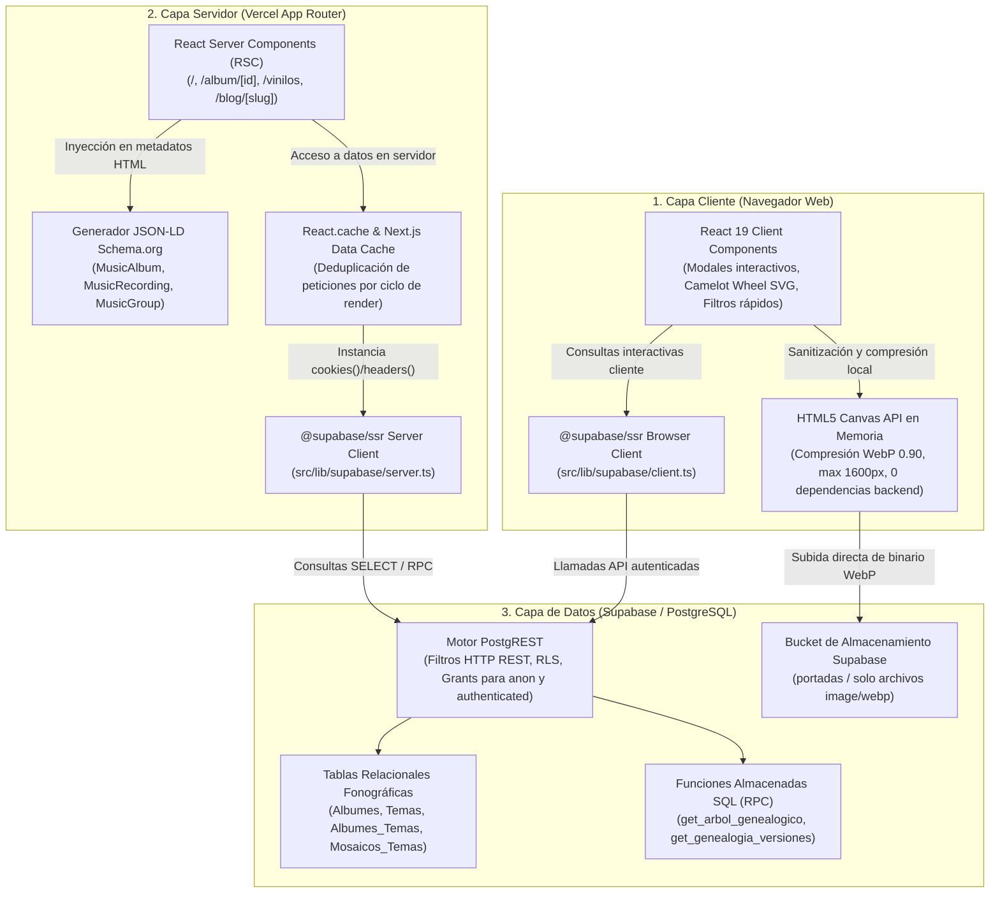
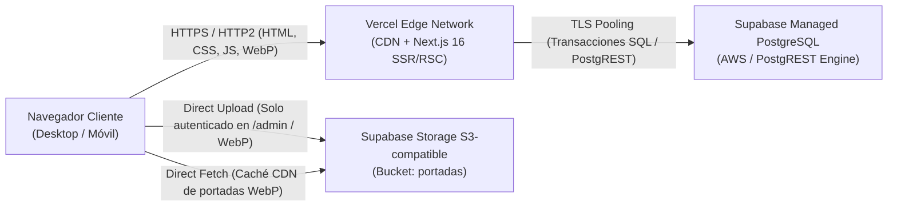
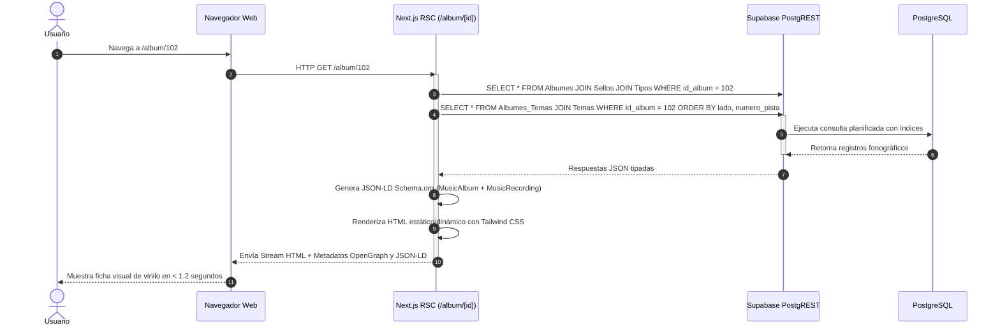
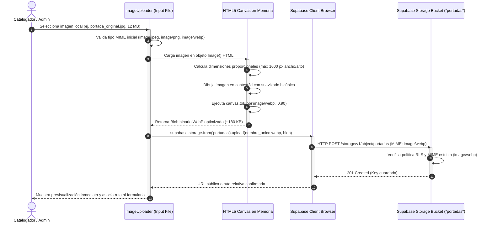
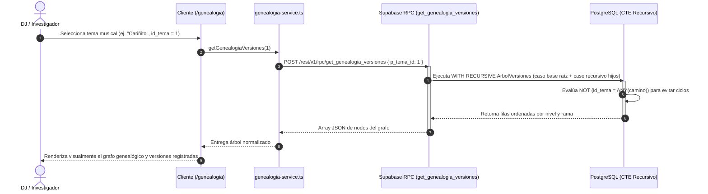

# 03 · Arquitectura de Software y Pipeline Multimedia

> **Propósito:** Explicar cómo está construido el sistema Kumbia Sound, sus capas de software, flujos de datos, pipeline de conversión multimedia en cliente, estructura física del código y restricciones inviolables de desarrollo.
> **Responde a:**
> - ¿Cómo se organizan y comunican las capas entre cliente (React 19), servidor (Next.js 16 App Router) y base de datos (Supabase PostgREST / RPC)?
> - ¿Cómo funciona el pipeline de compresión y sanitización de portadas a WebP en el navegador mediante HTML5 Canvas API?
> - ¿Cuál es la estructura física real de directorios y qué responsabilidades tiene cada módulo en `src/`?
> - ¿Qué restricciones arquitectónicas rigen el desarrollo y cómo se verifican para evitar regresiones?
> **Fuente principal de:** Capas de software, componentes de `src/`, pipeline Canvas WebP, flujos de secuencia e invariantes técnicas de código.
> **No contiene (ver):**
> - Diccionario de tablas, campos y relaciones de base de datos → [modelo-de-datos.md](file:///c:/Users/CACTU/Downloads/Proyectos/cumbia-peruana/docs/03-arquitectura/modelo-de-datos.md)
> - Contratos de funciones RPC y JSON-LD → [interfaces.md](file:///c:/Users/CACTU/Downloads/Proyectos/cumbia-peruana/docs/03-arquitectura/interfaces.md)
> - Decisiones de diseño y ADRs → [decisiones.md](file:///c:/Users/CACTU/Downloads/Proyectos/cumbia-peruana/docs/03-arquitectura/decisiones.md)
> - Guía de instalación y entorno local → [instalacion-y-entorno.md](file:///c:/Users/CACTU/Downloads/Proyectos/cumbia-peruana/docs/05-entorno-y-operacion/instalacion-y-entorno.md)
> **Depende de:**
> - [glosario.md](file:///c:/Users/CACTU/Downloads/Proyectos/cumbia-peruana/docs/01-proyecto/glosario.md)
> - [dominio.md](file:///c:/Users/CACTU/Downloads/Proyectos/cumbia-peruana/docs/01-proyecto/dominio.md)
> - [requisitos.md](file:///c:/Users/CACTU/Downloads/Proyectos/cumbia-peruana/docs/02-requisitos/requisitos.md)
> **Entregar a otra IA para:** Evaluar refactorizaciones arquitectónicas, auditar capas de Server vs. Client Components, revisar dependencias circulares o implementar nuevos módulos en `src/features/`.
> **Estado:** VIGENTE · **Última revisión:** 2026-10-31 · **Describe la versión:** commit 04ef58c

---

## 1. Visión Global del Sistema

Kumbia Sound implementa una arquitectura web moderna desacoplada en tres capas principales: Capa de Presentación en Navegador (React 19 Client Components), Capa de Servidor (Next.js 16 App Router sobre Node.js / Vercel Edge Runtime) y Capa de Datos y Persistencia (Supabase PostgreSQL, PostgREST y Storage Bucket).



### 1.1 Diagrama de Despliegue Físico



---

## 2. Stack Tecnológico y Justificación

| Capa / Tecnología | Versión Verificada | Justificación Técnica | Enlace a Decisión |
| :--- | :--- | :--- | :--- |
| **Next.js (App Router)** | `16.3.5` | Renderizado híbrido RSC + SSR para indexación SEO patrimonial masiva sin coste de cliente; optimización Turbopack. | [DEC-005](file:///c:/Users/CACTU/Downloads/Proyectos/cumbia-peruana/docs/03-arquitectura/decisiones.md#dec-005) |
| **React** | `19.2.8` | Soporte nativo para Server Actions, transiciones concurrentes y streaming de HTML con `Suspense`. | [DEC-005](file:///c:/Users/CACTU/Downloads/Proyectos/cumbia-peruana/docs/03-arquitectura/decisiones.md#dec-005) |
| **Tailwind CSS** | `^4.0.0` | Arquitectura de estilos CSS sin JavaScript en tiempo de ejecución, variables CSS nativas y renderizado ultrarrápido para diseño neo-brutalista. | [sistema-visual.md](file:///c:/Users/CACTU/Downloads/Proyectos/cumbia-peruana/docs/04-diseno/sistema-visual.md) |
| **TypeScript** | `^5` | Tipado estricto de entidades fonográficas derivadas de la base de datos para prevenir inconsistencias de catálogo. | [requisitos.md](file:///c:/Users/CACTU/Downloads/Proyectos/cumbia-peruana/docs/02-requisitos/requisitos.md#rnf-005) |
| **Supabase SSR** | `@supabase/ssr` `^0.5.2` | Manejo seguro de sesiones y cookies tanto en Server Components como en Client Components sin fugas de credenciales. | [seguridad-y-datos.md](file:///c:/Users/CACTU/Downloads/Proyectos/cumbia-peruana/docs/06-calidad/seguridad-y-datos.md) |
| **PostgreSQL (Supabase)** | `15+` | Integridad referencial con restricciones `CHECK`, disparadores de negocio y funciones PL/pgSQL recursivas para grafos. | [DEC-001](file:///c:/Users/CACTU/Downloads/Proyectos/cumbia-peruana/docs/03-arquitectura/decisiones.md#dec-001), [DEC-003](file:///c:/Users/CACTU/Downloads/Proyectos/cumbia-peruana/docs/03-arquitectura/decisiones.md#dec-003) |
| **HTML5 Canvas API** | Nativo del navegador | Pipeline cliente de compresión WebP sin dependencias pesadas en Node.js (Sharp/Jimp) ni costos de cómputo en Vercel. | [DEC-004](file:///c:/Users/CACTU/Downloads/Proyectos/cumbia-peruana/docs/03-arquitectura/decisiones.md#dec-004) |

---

## 3. Componentes y Responsabilidades

| Componente / Módulo | Responsabilidad Principal | Depende de | Prohibido que dependa de | Ruta en el Código |
| :--- | :--- | :--- | :--- | :--- |
| **App Shell & Layout** | Estructura común, metadatos raíz, navbar brutalista y footer institucional. | `src/lib/utils.ts`, `globals.css` | Supabase Client directo (debe mantenerse agnóstico de sesión). | [`src/app/layout.tsx`](file:///c:/Users/CACTU/Downloads/Proyectos/cumbia-peruana/src/app/layout.tsx) |
| **Módulo Álbumes** | Vistas de detalle de LP/Single, tracklist de surcos A/B, visualizador de galletas y créditos. | `src/features/temas`, `@supabase/ssr` server | Componentes interactivos de DJ (`match-bpm`). | [`src/app/album/`](file:///c:/Users/CACTU/Downloads/Proyectos/cumbia-peruana/src/app/album), [`src/features/albumes`](file:///c:/Users/CACTU/Downloads/Proyectos/cumbia-peruana/src/features/albumes) |
| **Módulo Match BPM** | Motor interactivo de mezcla armónica, rueda Camelot y filtrado de temas compatibles. | `src/features/camelot`, `src/types/domain.ts` | Lógica de mutación o escritura en base de datos. | [`src/app/match-bpm/`](file:///c:/Users/CACTU/Downloads/Proyectos/cumbia-peruana/src/app/match-bpm), [`src/features/camelot`](file:///c:/Users/CACTU/Downloads/Proyectos/cumbia-peruana/src/features/camelot) |
| **Módulo Genealogía** | Renderizado del árbol de sesionistas, fundaciones y versiones recursivas mediante RPC. | `src/features/genealogia/services`, Supabase RPC | Manipulación directa del DOM o canvas externo. | [`src/app/genealogia/`](file:///c:/Users/CACTU/Downloads/Proyectos/cumbia-peruana/src/app/genealogia), [`src/features/genealogia`](file:///c:/Users/CACTU/Downloads/Proyectos/cumbia-peruana/src/features/genealogia) |
| **Pipeline Storage** | Componente visual `ImageUploader` para redimensionar, comprimir a WebP y cargar a Supabase. | HTML5 Canvas API, `@supabase/ssr` browser | Librerías pesadas de Node.js o procesamiento en SSR. | [`src/features/storage/components/image-uploader.tsx`](file:///c:/Users/CACTU/Downloads/Proyectos/cumbia-peruana/src/features/storage/components/image-uploader.tsx) |
| **Panel Admin** | Interfaz de edición fonográfica para grupos, álbumes y pistas con protección de ruta. | `@supabase/ssr` browser, `src/features/storage` | Inyección de datos sin validar o scripts externos. | [`src/app/admin/`](file:///c:/Users/CACTU/Downloads/Proyectos/cumbia-peruana/src/app/admin) |
| **Generador SEO** | Inyección de schemas `MusicAlbum`, `MusicRecording` y `MusicGroup` en formato JSON-LD. | `src/types/domain.ts` | Estado de cliente o componentes con directiva `'use client'`. | [`src/components/seo/`](file:///c:/Users/CACTU/Downloads/Proyectos/cumbia-peruana/src/components/seo) |

---

## 4. Flujos de Datos y Secuencias Críticas

### 4.1 Carga y Renderizado de Álbum Fonográfico (RSC + SEO)



### 4.2 Pipeline de Conversión y Carga de Portadas WebP en Cliente



### 4.3 Consulta Recursiva de Árbol de Versiones (RPC)



---

## 5. Estructura Real de Directorios del Repositorio

La siguiente estructura refleja fielmente el árbol de directorios del proyecto en el commit `04ef58c`:

```text
cumbia-peruana/
├── docs/                               # Sistema documental estricto (v1.0)
│   ├── _sistema/                       # Metadocumentación e instrucciones maestras
│   ├── 01-proyecto/                    # Glosario, presentación y dominio fonográfico
│   ├── 02-requisitos/                  # Requisitos funcionales, no funcionales y flujos
│   ├── 03-arquitectura/                # Arquitectura de software, modelo y contratos
│   ├── 04-diseno/                      # Sistema visual neo-brutalista y pantallas
│   ├── 05-entorno-y-operacion/         # Instalación limpia, entorno y despliegue
│   ├── 06-calidad/                     # Pruebas, rendimiento y seguridad de datos
│   ├── 07-gestion/                     # Git, roadmap, changelog y catálogo de skills
│   ├── datos-investigacion/            # Hoja de cálculo ODS de catalogación de campo
│   └── sql-referencia/                 # DDL estructural y esquemas PostgreSQL
├── src/                                # Código fuente de la aplicación Next.js
│   ├── app/                            # Rutas App Router (Next.js 16)
│   │   ├── admin/                      # Panel de administración y catálogo (/admin)
│   │   │   ├── grupo/                  # Edición de agrupaciones musicales
│   │   │   │   └── [id]/page.tsx       # Formulario de edición por agrupación
│   │   │   ├── login/                  # Inicio de sesión administrativo
│   │   │   ├── layout.tsx              # Shell y verificación de sesión admin
│   │   │   └── page.tsx                # Dashboard general de catalogación
│   │   ├── album/                      # Fichas discográficas detalladas
│   │   │   └── [id]/                   # Ruta dinámica por id de álbum
│   │   │       ├── loading.tsx         # Esqueleto de carga visual (Skeleton)
│   │   │       ├── opengraph-image.tsx # Generador dinámico de tarjeta OpenGraph
│   │   │       └── page.tsx            # Página RSC de detalle fonográfico
│   │   ├── blog/                       # Artículos y notas de investigación musicológica
│   │   │   ├── [slug]/page.tsx         # Detalle de artículo histórico
│   │   │   └── page.tsx                # Índice general de publicaciones
│   │   ├── genealogia/page.tsx         # Explorador interactivo de grafos de músicos
│   │   ├── match-bpm/page.tsx          # Consola DJ de mezcla armónica y rueda Camelot
│   │   ├── nosotros/page.tsx           # Manifiesto fundacional y criterios de archivo
│   │   ├── radar/page.tsx              # Radar sonoro de estilos y sellos por época
│   │   ├── vinilos/                    # Catálogo discográfico general
│   │   │   ├── loading.tsx             # Indicador de streaming de colección
│   │   │   └── page.tsx                # Grilla de vinilos con filtros rápidos
│   │   ├── error.tsx                   # Límite de captura de errores en cliente
│   │   ├── globals.css                 # Importación de Tailwind CSS v4 y tokens
│   │   ├── layout.tsx                  # Layout maestro de toda la aplicación
│   │   ├── not-found.tsx               # Vista 404 personalizada neo-brutalista
│   │   └── page.tsx                    # Portada (Home) de alto impacto visual
│   ├── components/                     # Componentes UI transversales y reutilizables
│   │   ├── seo/                        # Componentes inyectores de JSON-LD Schema.org
│   │   └── ui/                         # Botones, tarjetas y contenedores brutalistas
│   ├── features/                       # Módulos organizados por dominio funcional
│   │   ├── albumes/                    # Lógica de presentación y componentes de vinilos
│   │   ├── camelot/                    # Rueda armónica SVG y cálculo de claves
│   │   ├── genealogia/                 # Componentes y servicios del grafo musical
│   │   │   ├── components/             # Modales y exploradores del árbol
│   │   │   └── services/               # Clientes Supabase SSR (client y server)
│   │   ├── home-brutalism/             # Secciones específicas de la portada brutalista
│   │   ├── home-retro/                 # Widgets auxiliares (command palette, radar)
│   │   ├── storage/                    # Pipeline multimedia de portadas (ImageUploader)
│   │   └── temas/                      # Tablas de tracklist para vinilos y surcos
│   ├── lib/                            # Utilidades de infraestructura y clientes base
│   │   ├── services/archive-stats.ts   # Métricas y estadísticas de catálogo
│   │   ├── supabase/                   # Configuración del cliente Supabase
│   │   │   ├── client.ts               # Cliente para Client Components (Browser)
│   │   │   └── server.ts               # Cliente para Server Components (Cookies/RSC)
│   │   └── utils.ts                    # Helpers de formato, clases y tiempo
│   └── types/                          # Definiciones de tipos TypeScript del sistema
│       ├── blog.ts                     # Interfaces de artículos editoriales
│       ├── database.ts                 # Tipos automáticos de tablas de Supabase
│       └── domain.ts                   # Tipos de dominio musicológico y Camelot
├── scripts/                            # Scripts Node.js para ingesta y mantenimiento
├── public/                             # Recursos estáticos servidos en la raíz
├── package.json                        # Manifiesto de dependencias npm
├── tsconfig.json                       # Configuración de compilador TypeScript
└── next.config.ts                      # Configuración de compilación Next.js
```

---

## 6. Estado y Persistencia

| Tipo de Dato | Dónde Vive | Formato / Motor | Versión / Estrategia | Política de Respaldo |
| :--- | :--- | :--- | :--- | :--- |
| **Metadatos Fonográficos** | Supabase Cloud | Tablas relacionales PostgreSQL | Esquema estructural v1.0 ([estructural.sql](file:///c:/Users/CACTU/Downloads/Proyectos/cumbia-peruana/docs/sql-referencia/estructural.sql)) | Copias diarias automáticas en Supabase y volcados DDL en git. |
| **Arte Gráfico (Portadas)** | Supabase Storage | Archivos binarios `image/webp` | Compresión local (calidad 0.90, máx 1600 px) | Almacenamiento distribuido S3 con versionado de archivos. |
| **Caché de Renderizado** | Vercel Edge / Node | Memoria de servidor RSC | Next.js Data Cache con revalidación bajo demanda | Volátil; se reconstituye automáticamente desde PostgreSQL. |
| **Sesión Administrativa** | Navegador (Cookies) | JWT seguro (HttpOnly, Secure) | Supabase Auth sesión PKCE | Gestionada por tokens de refresco en Supabase Auth. |
| **Investigación de Campo** | Directorio local del proyecto | Formato ODS (OpenDocument) | Archivo `docs/datos-investigacion/Datos BD.ods` | Versionado manual y commit periódico en repositorio Git. |

---

## 7. Concurrencia y Manejo de Recursos

1. **Concurrencia en Consultas Web:**
   - La capa pública de consulta es estrictamente de lectura (`SELECT`).
   - Las conexiones a Supabase desde Vercel utilizan el pooler transaccional de PostgREST, garantizando hasta cientos de lecturas concurrentes sin saturar los procesos de PostgreSQL.
2. **Consultas Complejas y Paralelismo:**
   - En componentes RSC donde se requieren datos de cabecera de álbum y su tracklist, se utiliza `Promise.all` para disparar las lecturas en paralelo, evitando cascadas de red (*waterfalls*).
   - Las funciones RPC recursivas (`get_genealogia_versiones`) ejecutan la búsqueda jerárquica dentro del motor PostgreSQL mediante CTEs en memoria, transfiriendo un único payload compacto al cliente.
3. **Manejo de Carga Multimedia:**
   - La compresión de imágenes se delega al procesador local del cliente mediante la Canvas API antes del envío. Esto elimina la necesidad de workers pesados en el backend y protege la CPU de la instancia serverless de Vercel.

---

## 8. Manejo de Errores y Registro (Logging)

- **Límites de Error en UI (`error.tsx`):** La ruta raíz y subrutas críticas cuentan con boundaries de React que capturan excepciones no controladas en tiempo de ejecución, mostrando una pantalla de error con estilo neo-brutalista y botón de reintento sin romper toda la interfaz.
- **Rutas Inexistentes (`not-found.tsx`):** Toda petición a un álbum, grupo o slug que retorne `null` desde Supabase activa la función `notFound()` de Next.js, presentando una página 404 estandarizada y rastreable.
- **Registro en Consola y Producción:** Los errores de llamadas PostgREST o Supabase Storage se capturan en bloques `try/catch` estructurados y se registran en los logs de ejecución de Vercel con el contexto de la entidad fallida (`id_album`, `id_tema`).

---

## 9. Restricciones Arquitectónicas Inviolables

Todo cambio o extensión en el código debe acatar de manera estricta las siguientes reglas:

1. **Restricción de Soporte Físico:** Ninguna consulta, mutación o interfaz admitirá lados distintos a `'A'` o `'B'` para discos de vinilo (`INV-001`, [DEC-001](file:///c:/Users/CACTU/Downloads/Proyectos/cumbia-peruana/docs/03-arquitectura/decisiones.md#dec-001)).
2. **Formato Exclusivo Multimedia:** Ninguna imagen puede ser subida al storage si su formato no es `image/webp` sanitizado ([DEC-004](file:///c:/Users/CACTU/Downloads/Proyectos/cumbia-peruana/docs/03-arquitectura/decisiones.md#dec-004)).
3. **Cero Dependencias de Audio Ilegal:** Queda terminantemente prohibido almacenar archivos de audio comercial (`.mp3`, `.wav`, `.flac`) en el servidor o en Supabase Storage (`INV-005`).
4. **Separación de Lados y Mosaicos:** Todo surco continuo que contenga más de una composición debe modelarse como `es_mosaico = TRUE` y desglosarse en `Mosaicos_Temas` (`INV-002`, [DEC-002](file:///c:/Users/CACTU/Downloads/Proyectos/cumbia-peruana/docs/03-arquitectura/decisiones.md#dec-002)).
5. **Aislamiento de Clientes Supabase:** Los Server Components (`RSC`) deben utilizar exclusivamente el cliente de `src/lib/supabase/server.ts`; los Client Components deben utilizar exclusivamente `src/lib/supabase/client.ts`.

---

## 10. Puntos de Extensión

- **Adición de Nuevos Módulos Funcionales:** Se deben crear dentro de `src/features/<nuevo-modulo>/` con la estructura canónica `components/`, `services/` e `index.ts` público para encapsular la lógica antes de exponerla en `src/app/`.
- **Integración con Canales Externos (YouTube / Spotify):** Previsto en la arquitectura como enriquecimiento de metadatos mediante campos de enlace (`youtube_url`, `spotify_playlist_id`) sin almacenar binarios en la plataforma.
- **Nuevas Funciones Analíticas SQL:** Cualquier cálculo recursivo o de agregación masiva debe implementarse como procedimiento almacenado `SECURITY DEFINER` o función `STABLE` en PostgreSQL e invocarse mediante `supabase.rpc()`.

---

## 11. Límites Conocidos y Trampas Comunes

- **Confusión de Clientes Supabase:** Importar el cliente de navegador en un Server Component romperá el renderizado en servidor al intentar acceder a la API `window`.
- **N+1 en Listados de Vinilos:** Consultar los temas de cada álbum dentro de un bucle `map` en el cliente satura el pool de conexiones; los tracklists deben consultarse únicamente en la vista de detalle o unificarse en una única consulta agregada.
- **Archivos No WebP:** Intentar subir directamente un `.jpg` sin pasar por el `ImageUploader` fallará con un error `403 Forbidden` debido a la política de almacenamiento configurada en Supabase Storage.

---

## 12. Actualizar Cuando

- Se actualicen las versiones de Next.js, React o Supabase.
- Se agregue un nuevo módulo funcional dentro de `src/features/`.
- Se modifique la estrategia de almacenamiento o procesamiento de imágenes.
- Se implemente una nueva política arquitectónica de rendimiento o caché.
