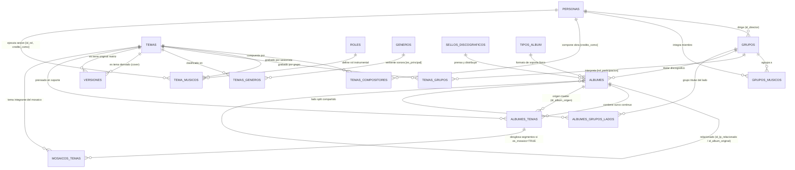

# 03 · Modelo Relacional Fonográfico y Diccionario de Datos

> **Propósito:** Contrato unificado de persistencia fonográfica: estructura de tablas, diccionario exhaustivo de campos, restricciones físicas de soporte vinilo, procedimientos almacenados y mapeo con fuentes de campo.
> **Responde a:**
> - ¿Cuáles son las tablas, columnas, tipos de datos y llaves primarias/foráneas del sistema?
> - ¿Cómo se mapean las columnas de la hoja de catalogación de campo (`Datos BD.ods`) a la base de datos relacional?
> - ¿Qué restricciones de integridad (`CHECK`, `UNIQUE`) protegen el modelo contra corrupciones fonográficas?
> - ¿Cuál es el volumen actual de registros frente a la escala objetivo del archivo patrimonial?
> **Fuente principal de:** Esquema relacional PostgreSQL, diccionario de campos, restricciones DDL, triggers de catálogo y correspondencias de ingestión.
> **No contiene (ver):**
> - Invariantes y reglas históricas del dominio → [dominio.md](file:///c:/Users/CACTU/Downloads/Proyectos/cumbia-peruana/docs/01-proyecto/dominio.md)
> - Capas de software y clientes Next.js → [arquitectura.md](file:///c:/Users/CACTU/Downloads/Proyectos/cumbia-peruana/docs/03-arquitectura/arquitectura.md)
> - Firmas y ejemplos de ejecución de RPCs → [interfaces.md](file:///c:/Users/CACTU/Downloads/Proyectos/cumbia-peruana/docs/03-arquitectura/interfaces.md)
> - Historial de decisiones de esquema (Lado A/B, Mosaicos) → [decisiones.md](file:///c:/Users/CACTU/Downloads/Proyectos/cumbia-peruana/docs/03-arquitectura/decisiones.md)
> **Depende de:**
> - [glosario.md](file:///c:/Users/CACTU/Downloads/Proyectos/cumbia-peruana/docs/01-proyecto/glosario.md)
> - [dominio.md](file:///c:/Users/CACTU/Downloads/Proyectos/cumbia-peruana/docs/01-proyecto/dominio.md)
> **Entregar a otra IA para:** Diseñar scripts de migración DDL, escribir consultas analíticas SQL complejas, auditar integridad referencial o programar nuevos scripts de ingesta.
> **Estado:** VIGENTE · **Última revisión:** 2026-10-31 · **Describe la versión:** commit 04ef58c

---

## 1. Diagrama Entidad-Relación Fonográfico (E-R)

---

## 2. Diccionario Exhaustivo de Entidades y Campos

### 2.1 Tablas Maestras Biográficas e Institucionales

#### `Personas`
Músicos de sesión, directores, compositores y cantantes del archivo fonográfico.

| Campo | Tipo | Obligatorio | Formato / Rango | Regla de Validación | Significado y Destino |
| :--- | :--- | :--- | :--- | :--- | :--- |
| `id_persona` | `SERIAL` | Sí | Entero > 0 | `PRIMARY KEY` | Identificador único de persona. |
| `nombre` | `VARCHAR(100)` | Sí | Texto limpio | `NOT NULL` | Nombre canónico de la persona (ej. "Víctor Casahuamán"). |
| `apodo` | `VARCHAR(100)` | No | Texto | Libre | Seudónimo o apelativo artístico (ej. "Chacalón", "Pascualillo"). |
| `fecha_nacimiento` | `DATE` | No | `AAAA-MM-DD` | Fecha válida | Fecha de nacimiento para cronología patrimonial. |
| `lugar_nacimiento` | `VARCHAR(100)` | No | Ciudad/Depto | Libre | Origen geográfico del músico. |
| `biografia` | `TEXT` | No | Texto libre | Libre | Reseña biográfica documentada. |
| `url_foto` | `VARCHAR(500)` | No | URL relativa WebP | Debe apuntar a bucket si existe | Retrato del artista (`portadas/personas/...`). |

#### `Grupos`
Orquestas, agrupaciones y conjuntos musicales.

| Campo | Tipo | Obligatorio | Formato / Rango | Regla de Validación | Significado y Destino |
| :--- | :--- | :--- | :--- | :--- | :--- |
| `id_grupo` | `SERIAL` | Sí | Entero > 0 | `PRIMARY KEY` | Identificador único de la agrupación. |
| `nombre_grupo` | `VARCHAR(100)` | Sí | Texto limpio | `NOT NULL` | Nombre oficial de la orquesta (ej. "Grupo Celeste", "Los Destellos"). |
| `id_director` | `INT` | No | Entero > 0 | `FK -> Personas(id_persona) ON DELETE SET NULL` | Músico fundador o director musical titular. |
| `region` | `VARCHAR(100)` | No | Departamento | Libre | Región de origen (ej. "Lima", "Loreto", "Junín"). |
| `fecha_formacion` | `DATE` | No | `AAAA-MM-DD` | Fecha válida | Año o fecha de fundación de la banda. |
| `url_foto` | `VARCHAR(500)` | No | URL relativa WebP | Libre | Fotografía promocional histórica del grupo. |

#### `Sellos_Discograficos`
Casas productoras, prensadoras y matrices fonográficas.

| Campo | Tipo | Obligatorio | Formato / Rango | Regla de Validación | Significado y Destino |
| :--- | :--- | :--- | :--- | :--- | :--- |
| `id_sello` | `SERIAL` | Sí | Entero > 0 | `PRIMARY KEY` | Identificador único del sello discográfico. |
| `nombre_sello` | `VARCHAR(100)` | Sí | Texto limpio | `NOT NULL` | Nombre oficial de la disquera (ej. "Discos Horóscopo", "Infopesa"). |
| `pais` | `VARCHAR(100)` | No | País | Valor por defecto 'Perú' | País de operación de la matriz. |
| `url_logo` | `VARCHAR(500)` | No | URL relativa WebP | Libre | Logotipo histórico del sello discográfico. |

#### `Generos`
Vertientes y estilos sonoros de la cumbia peruana (1968–2005).

| Campo | Tipo | Obligatorio | Formato / Rango | Regla de Validación | Significado y Destino |
| :--- | :--- | :--- | :--- | :--- | :--- |
| `id_genero` | `SERIAL` | Sí | Entero > 0 | `PRIMARY KEY` | Identificador único del género. |
| `nombre_genero` | `VARCHAR(50)` | Sí | Texto limpio | `NOT NULL UNIQUE` | Denominación musicológica (ej. "Cumbia Costeña", "Chicha"). |

#### `Tipos_Album`
Soportes físicos fonográficos catalogados.

| Campo | Tipo | Obligatorio | Formato / Rango | Regla de Validación | Significado y Destino |
| :--- | :--- | :--- | :--- | :--- | :--- |
| `id_tipo_album` | `SERIAL` | Sí | Entero (1 a 5) | `PRIMARY KEY`, `UNIQUE` | Formato físico: 1=Single 45, 2=LP 33, 3=EP, 4=Casete, 5=CD. |
| `nombre_tipo` | `VARCHAR(50)` | Sí | Texto limpio | `NOT NULL UNIQUE` | Etiqueta del formato físico. |

#### `Roles`
Especialidades instrumentales de sesión de grabación.

| Campo | Tipo | Obligatorio | Formato / Rango | Regla de Validación | Significado y Destino |
| :--- | :--- | :--- | :--- | :--- | :--- |
| `id_rol` | `SERIAL` | Sí | Entero > 0 | `PRIMARY KEY` | Identificador de rol instrumental. |
| `nombre_rol` | `VARCHAR(50)` | Sí | Texto limpio | `NOT NULL UNIQUE` | Función en grabación (ej. "Voz", "Primera Guitarra", "Timbales"). |

---

### 2.2 Soporte Físico y Publicaciones Discográficas

#### `Albumes`
Publicaciones comerciales en vinilo, casete o CD.

| Campo | Tipo | Obligatorio | Formato / Rango | Regla de Validación | Significado y Destino |
| :--- | :--- | :--- | :--- | :--- | :--- |
| `id_album` | `SERIAL` | Sí | Entero > 0 | `PRIMARY KEY` | Identificador único del álbum/disco. |
| `id_grupo` | `INT` | No | Entero > 0 | `FK -> Grupos(id_grupo)` | Grupo titular del álbum (NULL si es compilado multiorquesta). |
| `id_sello` | `INT` | No | Entero > 0 | `FK -> Sellos_Discograficos(id_sello)` | Sello que prensó el soporte físico. |
| `numero_catalogo` | `VARCHAR(50)` | No | Alfanumérico | Libre | Código de fábrica prensado (ej. "LPS-8001"). |
| `año_publicacion` | `SMALLINT` | No | 1960 a 2010 | Rango histórico | Año comercial de lanzamiento al mercado. |
| `nombre_album` | `VARCHAR(100)` | No | Texto limpio | Sync automático en singles | Título del disco. En singles se genera como "Lado A / Lado B". |
| `id_tipo_album` | `INT` | Sí | Entero 1 a 5 | `FK -> Tipos_Album(id_tipo_album)` | Tipo de soporte físico. |
| `es_recopilatorio` | `BOOLEAN` | No | Booleano | `DEFAULT FALSE` | Indica si el disco reúne grabaciones previas. |
| `es_varios_artistas` | `BOOLEAN` | No | Booleano | `DEFAULT FALSE` | Indica si incluye temas de múltiples agrupaciones. |
| `es_disco_split` | `BOOLEAN` | No | Booleano | `DEFAULT FALSE` | Álbum compartido entre grupos (un lado por orquesta). |
| `incluido_en_lp` | `BOOLEAN` | No | Booleano | `DEFAULT FALSE` | Para singles: indica si sus temas pasaron a un LP. |
| `extraido_de_lp` | `BOOLEAN` | No | Booleano | `DEFAULT FALSE` | Para singles: publicado como promocional extraído de un LP. |
| `solo_en_45` | `BOOLEAN` | No | Booleano | `DEFAULT FALSE` | Joya de coleccionista: tema nunca prensado en LP. |
| `lados_en_lp` | `VARCHAR(20)` | No | Cadena | Libre | Indicador de ubicación de los temas en el LP de destino. |
| `id_lp_relacionado` | `INT` | No | Entero > 0 | `FK -> Albumes(id_album)` | Puntero al álbum LP de larga duración vinculado. |
| `es_reedicion` | `BOOLEAN` | No | Booleano | `DEFAULT FALSE` | Prensaje posterior con cambio de catálogo o matriz. |
| `id_album_original` | `INT` | No | Entero > 0 | `FK -> Albumes(id_album)` | Puntero a la edición primera original. |
| `comentario` | `TEXT` | No | Texto libre | Libre | Notas de peritaje discográfico o rareza física. |
| `url_portada` | `VARCHAR(500)` | No | Ruta WebP | Libre | Archivo de arte de portada frontal. |
| `url_contraportada` | `VARCHAR(500)` | No | Ruta WebP | Libre | Archivo de contraportada con créditos y tracklist. |
| `url_etiqueta` | `VARCHAR(500)` | No | Ruta WebP | Libre | Galleta central del vinilo (Side Label). |

#### `Albumes_Grupos_Lados`
Partición física de álbumes split compartidos entre dos grupos.

| Campo | Tipo | Obligatorio | Formato / Rango | Regla de Validación | Significado y Destino |
| :--- | :--- | :--- | :--- | :--- | :--- |
| `id_album` | `INT` | Sí | Entero > 0 | `PK`, `FK -> Albumes(id_album)` | Álbum split de vinilo. |
| `lado` | `VARCHAR(10)` | Sí | `'A'` o `'B'` | `PK`, `CHECK (lado IN ('A', 'B'))` | Lado físico del disco. |
| `id_grupo` | `INT` | Sí | Entero > 0 | `FK -> Grupos(id_grupo)` | Agrupación titular exclusiva de dicho lado. |

---

### 2.3 Obras Musicales y Pistas Físicas

#### `Temas`
Obras intelectuales y grabaciones de audio abstractas.

| Campo | Tipo | Obligatorio | Formato / Rango | Regla de Validación | Significado y Destino |
| :--- | :--- | :--- | :--- | :--- | :--- |
| `id_tema` | `SERIAL` | Sí | Entero > 0 | `PRIMARY KEY` | Identificador único de la obra musical. |
| `titulo_tema` | `VARCHAR(100)` | Sí | Texto limpio | `NOT NULL` | Título de la composición musical. |
| `duracion_segundos` | `INT` | No | Entero > 0 | Segundos enteros | Duración exacta de la toma sonora (`INV-003`). |
| `letra` | `TEXT` | No | Texto lírico | Índice GIN en español | Texto poético completo de la canción. |
| `id_genero` | `INT` | No | Entero > 0 | `FK -> Generos(id_genero)` | Género sonoro principal de la obra. |
| `bpm` | `INT` | No | 50 a 200 | Tempo DJ | Pulsos por minuto medidos para mezcla armónica. |
| `camelot_code` | `VARCHAR(10)` | No | `1A` a `12B` | `INV-004` | Notación armónica Camelot exclusiva. |

#### `Albumes_Temas`
Surco físico continuo prensado en el soporte vinilo.

| Campo | Tipo | Obligatorio | Formato / Rango | Regla de Validación | Significado y Destino |
| :--- | :--- | :--- | :--- | :--- | :--- |
| `id_album_tema` | `SERIAL` | Sí | Entero > 0 | `PRIMARY KEY` | Identificador del surco físico en el vinilo. |
| `id_album` | `INT` | Sí | Entero > 0 | `FK -> Albumes(id_album)` | Álbum que contiene el surco físico. |
| `id_tema` | `INT` | Sí | Entero > 0 | `FK -> Temas(id_tema)` | Tema musical prensado en la pista. |
| `numero_pista` | `INT` | No | Entero >= 1 | Orden en el lado | Posición secuencial del surco en la cara del disco. |
| `lado` | `VARCHAR(10)` | No | `'A'` o `'B'` | `CHECK (lado IN ('A', 'B'))` | Cara física del disco vinilo (`INV-001`). |
| `id_album_origen` | `INT` | No | Entero > 0 | `FK -> Albumes(id_album)` | Álbum máster original donde se prensó por primera vez. |
| `es_grabacion_inedita` | `BOOLEAN` | No | Booleano | `DEFAULT FALSE` | Toma o mezcla nunca publicada previamente. |
| `es_mosaico` | `BOOLEAN` | No | Booleano | `DEFAULT FALSE` | Indica si el surco físico es un popurrí continuo. |

#### `Mosaicos_Temas`
Desglose musical de canciones contenidas en un surco continuo tipo popurrí/enganchado.

| Campo | Tipo | Obligatorio | Formato / Rango | Regla de Validación | Significado y Destino |
| :--- | :--- | :--- | :--- | :--- | :--- |
| `id_mosaico_tema` | `SERIAL` | Sí | Entero > 0 | `PRIMARY KEY` | Identificador de segmento de mosaico. |
| `id_album_tema` | `INT` | Sí | Entero > 0 | `FK -> Albumes_Temas(id_album_tema)` | Puntero al surco físico continuo del álbum. |
| `id_tema` | `INT` | Sí | Entero > 0 | `FK -> Temas(id_tema)` | Canción individual que forma parte del enganchado. |
| `orden_segmento` | `SMALLINT` | Sí | Entero >= 1 | `CHECK (orden_segmento > 0)` | Posición secuencial dentro de la pista continua. |
| `duracion_segmento_segundos` | `INT` | No | Entero > 0 | Segundos enteros | Duración aproximada de dicho segmento. |

---

### 2.4 Créditos, Sesionistas y Versiones

#### `Temas_Compositores`
Autorías de composiciones musicales y créditos en galleta.

| Campo | Tipo | Obligatorio | Formato / Rango | Regla de Validación | Significado y Destino |
| :--- | :--- | :--- | :--- | :--- | :--- |
| `id_tema` | `INT` | Sí | Entero > 0 | `PK`, `FK -> Temas(id_tema)` | Obra musical compuesta. |
| `id_compositor` | `INT` | Sí | Entero > 0 | `PK`, `FK -> Personas(id_persona)` | Persona que compuso la obra. |
| `credito_como` | `VARCHAR(150)` | No | Texto literal | Libre | Texto exacto impreso en la galleta (ej. "D.R.", seudónimo). |

#### `Tema_Musicos`
Músicos de estudio que grabaron en la sesión física del tema.

| Campo | Tipo | Obligatorio | Formato / Rango | Regla de Validación | Significado y Destino |
| :--- | :--- | :--- | :--- | :--- | :--- |
| `id_tema_musicos` | `SERIAL` | Sí | Entero > 0 | `PRIMARY KEY` | Identificador de participación de sesión. |
| `id_tema` | `INT` | Sí | Entero > 0 | `FK -> Temas(id_tema)` | Tema musical ejecutado. |
| `id_musico` | `INT` | Sí | Entero > 0 | `FK -> Personas(id_persona)` | Persona que ejecutó el instrumento o voz. |
| `instrumento` | `VARCHAR(50)` | No | Texto | Libre | Denominación del instrumento (ej. "Voz", "Guitarra"). |
| `id_rol` | `INT` | Sí | Entero > 0 | `FK -> Roles(id_rol)` | Rol canónico de la tabla `Roles` (`5` = Voz). |
| `credito_como` | `VARCHAR(150)` | No | Texto | Libre | Seudónimo utilizado si grabó clandestinamente. |

#### `Versiones`
Red genealógica de regrabaciones, reinterpretaciones y *covers*.

| Campo | Tipo | Obligatorio | Formato / Rango | Regla de Validación | Significado y Destino |
| :--- | :--- | :--- | :--- | :--- | :--- |
| `id_version` | `SERIAL` | Sí | Entero > 0 | `PRIMARY KEY` | Identificador de relación de versión. |
| `id_tema` | `INT` | Sí | Entero > 0 | `FK -> Temas(id_tema)` | Tema musical derivado (*cover* o regrabación). |
| `id_tema_original` | `INT` | Sí | Entero > 0 | `FK -> Temas(id_tema)` | Tema matriz original primigenio. |
| - | - | - | - | `CHECK (id_tema <> id_tema_original)` | Previene autoreferencias cíclicas directas. |

---

## 3. Mapeo Externo: Hoja de Catalogación (`Datos BD.ods`) a Base de Datos

| Columna en Hoja ODS | Destino en PostgreSQL (Tabla.Columna) | Transformación / Regla de Ingestión |
| :--- | :--- | :--- |
| `GRUPO` | `Grupos.nombre_grupo` | Búsqueda/inserción por coincidencia exacta en `Grupos`. |
| `SELLO` | `Sellos_Discograficos.nombre_sello` | Normalización de sellos históricos (ej. "Horóscopo"). |
| `CATÁLOGO` | `Albumes.numero_catalogo` | Limpieza de espacios en blanco; se conserva código impreso. |
| `AÑO` | `Albumes.año_publicacion` | Conversión a `SMALLINT`. En fechas desconocidas se asigna `NULL`. |
| `FORMATO` | `Albumes.id_tipo_album` | Mapeo: "Single" / "45" -> 1; "LP" -> 2; "EP" -> 3; "Casete" -> 4; "CD" -> 5. |
| `LADO` | `Albumes_Temas.lado` | Forzado a mayúscula estricta `'A'` o `'B'`. Si es CD/Casete, `NULL`. |
| `PISTA` | `Albumes_Temas.numero_pista` | Conversión a `INT`. Secuencial por lado. |
| `TÍTULO DE LA CANCIÓN` | `Temas.titulo_tema` | Texto canónico de la obra musical. |
| `COMPOSITOR` | `Personas.nombre` + `Temas_Compositores` | Búsqueda de `id_persona`. Si no existe, se inserta registro maestro. |
| `CRÉDITO EN GALLETA` | `Temas_Compositores.credito_como` | Texto exacto de la galleta (D.R., seudónimo de autor). |
| `VOZ` | `Tema_Musicos` (`id_rol=5`, `instrumento='Voz'`) | Músico titular de la voz principal (`credito_como = NULL`). |
| `DURACIÓN` | `Temas.duracion_segundos` | Conversión de formato `MM:SS` a segundos enteros (`min * 60 + seg`). |
| `BPM` | `Temas.bpm` | Conversión a número entero de pulsos por minuto. |
| `CAMELOT` | `Temas.camelot_code` | Notación alfanumérica armónica (`1A` a `12B`). |
| `¿ES RECOPILATORIO?` | `Albumes.es_recopilatorio` | Conversión "Sí" / "TRUE" -> `TRUE`, vacío -> `FALSE`. |
| `¿ES GRABACIÓN INÉDITA?` | `Albumes_Temas.es_grabacion_inedita` | Booleano que documenta tomas inéditas en recopilatorios. |

---

## 4. Reglas de Integridad y Normalización

1. **Restricción de Dos Lados en Vinilo:**
   - La restricción `chk_albumes_temas_lados_ab` en `Albumes_Temas` garantiza que ningún disco pueda poseer lados 'C', 'D' o caracteres inválidos.
2. **Prevención de Bucles en Versiones:**
   - La restricción `chk_no_autoversion` impide que un tema sea versión de sí mismo. La recursión profunda en grafos está protegida por la comprobación `NOT (v.id_tema = ANY(av.camino))` en el CTE de PostgreSQL.
3. **Trigger de Sincronización de Singles de 45 RPM (`fn_sync_single_title`):**
   - Cuando un álbum tiene `id_tipo_album = 1`, la inserción o actualización de temas en el Lado A o Lado B actualiza automáticamente el campo `nombre_album` con la concatenación: `"<Título Lado A> / <Título Lado B>"`.

---

## 5. Volumen y Escala del Sistema

| Entidad | Registros Reales (Octubre 2026) | Escala Objetivo (Catálogo Integral) | Crecimiento Esperado |
| :--- | :--- | :--- | :--- |
| **Álbumes / Soportes** | 721 | 2,500 | +246 % (Ingesta de Los Destellos, Juaneco, Manzanita) |
| **Obras Musicales (`Temas`)** | 109 | 8,000 | +7,200 % (Digitalización completa de repertorios) |
| **Surcos Físicos (`Albumes_Temas`)**| 136 | 12,000 | +8,700 % (Reediciones, splits y recopilatorios) |
| **Compositores Registrados** | 118 | 1,200 | +916 % (Autores peruanos y extranjeros adaptados) |
| **Participaciones Vocales** | 101 | 3,500 | +3,365 % (Voz principal y coros de sesión) |
| **Segmentos de Mosaico** | 13 | 450 | +3,360 % (Popurrís de fiesta de fin de año) |
| **Géneros Musicales** | 22 | 35 | +59 % (Micro-vertientes regionales) |
| **Roles Instrumentales** | 16 | 25 | +56 % (Instrumentos tradicionales y electrónicos) |

---

## 6. Campos Ausentes Conocidos

- **`PEND-001` (Crédito en Galleta para Intérpretes en Vinilo):** La columna `credito_galleta` en `Albumes_Temas` se encuentra en evaluación para soportar seudónimos del conjunto musical impresos en la etiqueta cuando difieren del nombre oficial de la banda (ej. Los Hijos del Sol grabados como "El Conjunto Tropical de Manzanita").

---

## 7. Actualizar Cuando

- Se agregue o modifique una columna en cualquier tabla física de PostgreSQL.
- Se incorpore un nuevo formato fonográfico en `Tipos_Album`.
- Se ejecute una nueva migración DDL en Supabase.
- Se actualice la correspondencia con la hoja de catalogación `Datos BD.ods`.
