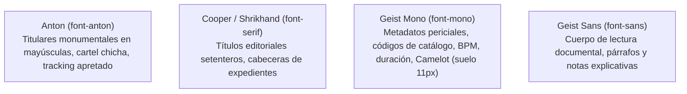

# 🪗 Sistema de Diseño Neo-Brutalista Editorial & Identidad Visual (Kumbia Sound)

> **CLASIFICACIÓN DEL DOCUMENTO:** `GUÍA CANÓNICA OFICIAL // SISTEMA DE DISEÑO // FOLIO 000-SYS`  
> **FILOSOFÍA:** `ARCHIVO NACIONAL DESCLASIFICADO MEETS NEO-BRUTALISMO SUIZO & VINTAGE VINYL EDITORIAL`  
> *Fusión unificada del Manual de Identidad Visual y la Guía de Implementación UI/UX.*

---

## 1. 🏛️ Filosofía y Metáfora Narrativa

La interfaz web de **Kumbia Sound** no es un SaaS genérico, ni una aplicación musical moderna con fondos oscuros borrosos (*dark glassmorphism*) ni bordes redondeados estándar.

El universo visual simula **un archivo pericial gubernamental y fonográfico de las décadas de 1970 y 1980 que acaba de ser desclasificado al público**:
* Cada disco prensado es una **evidencia física bajo custodia**.
* Cada subpágina es un **expediente pericial** (`EXP. 01` a `EXP. 06`).
* Cada canción es un **registro sonoro** o **corte de surco**.
* Las herramientas interactivas (Match BPM, Rueda Camelot, Consola DJ) son **maquinaria de peritaje y hardware analógico de alta precisión**.
* El usuario no "navega un catálogo": **consulta legajos, audita registros y abre bóvedas**.

---

## 2. 📐 Principios Rectores Inquebrantables

1. **Tangibilidad Analógica:** Todo debe evocar papel manila envejecido, cartón de carpeta de archivo, tinta de imprenta tipográfica, vinilo físico y sellos de caucho.
2. **Geometría 100% Ortogonal (`rounded-none`):** Queda terminantemente prohibido el uso de `rounded-xl`, `rounded-2xl` o `rounded-full` en contenedores estructurales principales, marcos de tarjetas y botones. Las esquinas son rectas con bordes sólidos de `2px`.
3. **Física Mecánica Coherente de Luz y Sombras:**
   - La fuente de luz proviene siempre de la esquina superior izquierda (`top-left`).
   - Las sombras caen rígidamente hacia abajo y la derecha (`+X, +Y`) sin difuminado (`blur 0`): `box-shadow: 4px 4px 0 #1F1305`.
   - **Interacción táctil:** Al hacer hover, el elemento se eleva hacia la luz; al hacer clic (`active`), se presiona mecánicamente contra el papel (`translate-x-[2px] translate-y-[2px]` con reducción de sombra).
4. **Suelo Tipográfico Mínimo de 11px:** Prohibición absoluta de microtextos ilegibles (`8px`, `9px`, `10px`). Todo metadato técnico pericial tiene como suelo `text-[11px]` en `font-mono`.
5. **Colores Sólidos sin Opacidades Fantasma:** Prohibidas las transparencias arbitrarias con canal alfa bajo (`/20`, `/15`, `/10`). Todos los colores de fondo, bordes y texto son sólidos y de alto contraste.
6. **Desambiguación Semántica del Rojo:** El color rojo (`#E80000`, `#C91D1D`) está reservado estrictamente para sellos periciales confidenciales, alertas del sistema y pitch frenado. El tempo (BPM) se presenta en tinta negra neutra (`#1F1305`).
7. **Arquitectura de Carpeta Archivadora Fusión:** La navegación no son botones flotantes; son pestañas de cartón físico que se fusionan de forma continua con la parte superior del expediente activo.
8. **Lenguaje Narrativo Institucional:** Se emplea vocabulario documental y musical (ej. en lugar de "Ver canciones" se usa "AUDITAR REGISTROS DEL PRENSAJE").

---

## 3. 🎨 Paleta Cromática Canónica y Tokens CSS

La paleta evoca papelería judicial, carátulas impresas en serigrafía y fundas de vinilo de sellos peruanos emblemáticos (*Infopesa, Discos Horóscopo, Sono Radio, El Virrey*):

| Rol Semántico | Nombre Visual | Valor HEX | Uso en la Aplicación |
| :--- | :--- | :--- | :--- |
| **Fondo Global** | Papel Manila | `#EDE0D0` | Fondo general con retícula de puntos de tinta a 16px. |
| **Tinta Principal** | Espresso Imprenta | `#1F1305` | Tipografía principal, bordes estructurales de 2px y sombras rígidas. |
| **Superficie Expediente**| Cartulina Manila Clara | `#F8F3EA` | Fondos de tarjetas de álbum, tablas y contenedores de lectura. |
| **Superficie Bóveda** | Búnker Oscuro | `#241607` | Paneles de hardware DJ, cajas de herramientas y footer. |
| **Acento Primario** | Rojo Sello de Caucho | `#E80000` | Sellos "DESCLASIFICADO", badges periciales, advertencias de archivo. |
| **Acento Secundario**| Naranja Radiactivo | `#F1730C` | Estados activos, botones primarios de acción y resaltados. |
| **Tinta Secundaria** | Sepia Desvanecido | `#6B5844` | Etiquetas secundarias, fechas, nombres de sellos y notas al pie. |
| **Acento Camelot A** | Ámbar Mayor | `#F9BA15` | Tonalidades mayores en la rueda Camelot. |
| **Acento Camelot B** | Esmeralda Menor | `#1E7B48` | Tonalidades menores en la rueda Camelot. |

---

## 4. 🔤 Sistema Tipográfico

El proyecto implementa cuatro familias tipográficas con propósitos específicos:

* **Jerarquía de Encabezados:**
  * `H1 (Hero / Títulos Principales):` `font-anton uppercase tracking-tight text-4xl md:text-7xl leading-[0.9] text-[#1F1305]`.
  * `H2 (Secciones de Expediente):` `font-serif text-2xl md:text-3xl text-[#1F1305] border-b-2 border-[#1F1305] pb-2`.
  * `Metadatos y Etiquetas:` `font-mono uppercase text-xs tracking-wider text-[#6B5844]`.

---

## 5. 🧩 Componentes de Interfaz Pericial

### A. Tarjeta de Álbum (Expediente Fonográfico)
* Estructura ortogonal con marco de `2px solid #1F1305`.
* Sombra sólida `4px 4px 0 #1F1305`.
* Ceja superior con número de evidencia (`EXP-LP-042`).
* Imagen de portada con proporción 1:1, borde inferior de separación y galleta de vinilo que asoma en hover.

### B. Sellos de Caucho Periciales
* Texto en mayúsculas dentro de un marco doble de borde rojo (`#E80000`).
* Transformación de rotación calculada entre `-3deg` y `4deg`.
* Opciones: `[CONFIDENCIAL // USO INTERNO]`, `[DESCLASIFICADO]`, `[MATRIZ ORIGINAL CERTIFICADA]`.

### C. Galleta de Vinilo Giratoria (`VinylSpinner`)
* Representación gráfica del disco de vinilo de 7'' o 12''.
* Surcos concéntricos en negro brillante y galleta central a todo color.
* Animación CSS continua de giro a 33 o 45 RPM cuando se reproduce audio o en interacción activa.

### D. Pestañas de Carpeta Fusión (Navegación Lado A / Lado B)
* Pestañas rectangulares superiores que se unen sin línea divisoria inferior con el contenedor principal de pistas.
* La pestaña activa tiene fondo `#F8F3EA` idéntico al de la tabla de canciones; las inactivas tienen fondo `#DFD2C0` con borde visible.

### E. Modales de Peritaje (`PeritajeDialog`)
* Overlay de papel semitranslúcido con patrón de puntos.
* Ventana central con cabecera de expediente judicial, barra de título contrastada y botón de cierre en cruz mecánica (`✕`).
* Sombra de búnker profunda `8px 8px 0 #1F1305`.

---

## 6. 📱 Comportamiento Responsive y Ergonomía

* **Desktop (1024px+):** Cuadrícula monumental a 12 columnas, tablas de tracklist completas con columnas de compositor, cantante, BPM y rueda Camelot.
* **Mobile / Tablet (<768px):** 
  * Las sombras rígidas se reducen de `4px 4px 0` a `2px 2px 0` para optimizar el espacio útil en pantalla.
  * Los titulares monumentales ajustan el interlineado a `leading-tight`.
  * Las tablas de tracklist ocultan metadatos secundarios manteniendo siempre visibles título, lado, duración y BPM.
