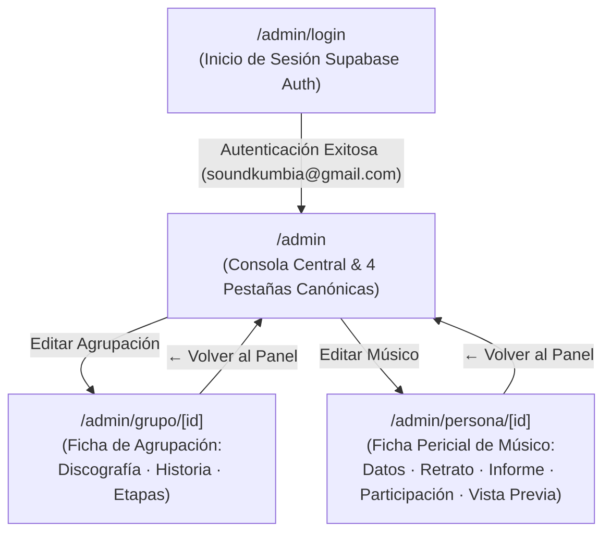
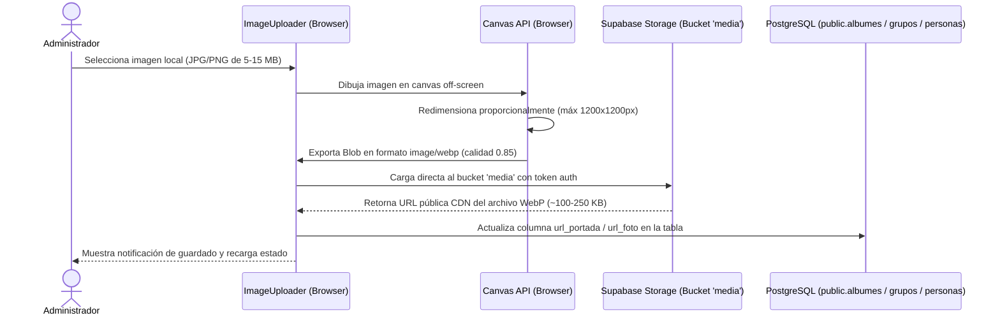

# 04 · Especificación de Estructura y Arquitectura del Panel Admin

> **Propósito:** Describir la arquitectura técnica, jerarquía de pantallas, módulos de gestión, espacios de escritura editorial, pipeline de imágenes WebP y controles de acceso del panel de administración (`/admin`) de Kumbia Sound.
> **Responde a:**
> - ¿Cómo está estructurado y ordenado el panel de administración?
> - ¿Qué módulos, pestañas y componentes lo integran?
> - ¿Cómo se organizan los espacios de escritura editorial (Informes, Historias de agrupaciones, Notas, Radar, Legajo)?
> - ¿Cómo funciona el editor reutilizable `EditorPericial` y sus validaciones periciales?
> - ¿Cómo se autentican los administradores y qué permisos tienen?
> - ¿Cómo funciona la subida y optimización de carátulas fotográficas?
> **Fuente principal de:** Estructura de vistas administrativas, formularios de catalogación, pipeline de medios, redacción editorial y configuración del CMS.
> **No contiene (ver):**
> - Vistas públicas y expedientes de usuario → [pantallas.md](file:///c:/Users/CACTU/Downloads/Proyectos/cumbia-peruana/docs/04-diseno/pantallas.md)
> - Políticas RLS de base de datos → [seguridad-y-datos.md](file:///c:/Users/CACTU/Downloads/Proyectos/cumbia-peruana/docs/06-calidad/seguridad-y-datos.md)
> - Caso de uso detallado → [flujos-de-usuario.md](file:///c:/Users/CACTU/Downloads/Proyectos/cumbia-peruana/docs/02-requisitos/flujos-de-usuario.md)
> **Estado:** VIGENTE · **Última revisión:** 2026-10-31

---

## 1. Mapa de Navegación del Panel Administrativo

El panel está completamente aislado del frontend público (no existen enlaces públicos en el menú, cintillo ni pie de página) y se accede únicamente mediante URL directa protegida:



---

## 2. Seguridad y Reglas de Acceso

1. **Rutas Protegidas:** `/admin`, `/admin/grupo/[id]` y `/admin/persona/[id]`.
2. **Mecanismo de Guardia (`layout.tsx` / `page.tsx`):**
   - Ejecuta en el servidor `supabase.auth.getUser()`.
   - Si no existe sesión activa o el correo no coincide con el administrador autorizado (`soundkumbia@gmail.com`), redirige inmediatamente por HTTP 307 a `/admin/login`.
3. **Manejo de Sesión:** Cookies seguras HttpOnly gestionadas a través del paquete `@supabase/ssr`.
4. **Protección RLS contra Filtraciones:**
   - Para tablas editoriales con estados de borrador (`informes_personas`, `grupo_historias`, `grupo_etapas`, `radar_hallazgos`, `articulos`), las consultas anónimas del público filtran estrictamente `(estado = 'publicado' AND (publish_at IS NULL OR publish_at <= now()))`. Los borradores y publicaciones programadas son invisibles para visitantes no autenticados.

---

## 3. Arquitectura de Pantallas y Componentes

### 3.1 Consola Central (`/admin`)
Coordinada por `AdminTabsContainer` con **4 pestañas canónicas**:

```text
+---------------------------------------------------------------------------------------------------------+
| [ 01 · RESUMEN ]   |   [ 02 · ARCHIVO ]   |   [ 03 · REDACCIÓN ]   |   [ 04 · PORTADA ]             |
+---------------------------------------------------------------------------------------------------------+
```

#### Pestaña 1 · RESUMEN (`AdminDashboardResumen`)
Panel integral de salud del archivo histórico que combina dos dimensiones:
- **Custodia Fotográfica:** Cobertura de imágenes en Álbumes, Grupos, Personas y Sellos.
- **Redacción Editorial:**
  - Informes publicados vs en borrador vs personas sin informe redactado.
  - Agrupaciones con historia redactada vs total de orquestas.
  - Notas de investigación publicadas vs borradores.
  - Estado del Radar del mes en curso (cubierto o pendiente).

#### Pestaña 2 · ARCHIVO (`AdminMediaManager`)
Gestor fonográfico estructurado con sub-pestañas:
- **Álbumes:** Búsqueda, filtros de formato (LP, 45 RPM, Casete, EP, CD) y completitud de carátulas (Cara A, Cara B, Galleta).
- **Grupos:** Listado de orquestas con desglose de lanzamientos y enlace a `/admin/grupo/[id]`.
- **Personas:** Directorio de músicos y compositores con uploader de retrato y enlace directo a `/admin/persona/[id]`.
- **Sellos:** Catálogo de casas discográficas históricas (Infopesa, Discos Horóscopo, Sono Radio, etc.) para logotipos.

#### Pestaña 3 · REDACCIÓN (`AdminMesaRedaccion`)
Centro editorial integral con vista de entrada unificada y navegación secundaria en 6 sub-módulos:
1. **Mesa de Redacción:** Bandeja consolidada con filtros cruzados por tipo (`informe`, `agrupacion`, `nota`) y estado (`publicado`, `borrador`), además de buscador en tiempo real.
2. **Informes Músicos:** Directorio pericial para redactar informes biográficos de pioneros con enlaces a `/admin/persona/[id]`.
3. **Historias Agrupaciones:** Fichas históricas de orquestas y líneas de tiempo.
4. **Notas (Blog):** Editor de crónicas con cálculo automático de lectura por número de palabras y categorías temáticas canónicas (*Crónica de Época*, *Sellos Discográficos*, *Prensajes y Matrices*, *Metodología Pericial*).
5. **Radar Mensual:** Gestor del hallazgo fonográfico mensual con la estructura canónica de 4 puntos (*Qué es*, *Por qué importa*, *Escúchalo*, *Explóralo*).
6. **Legajo Institucional:** Editor de los 5 bloques normativos del archivo (*Acta Fundacional*, *Equipo de Peritaje*, *Normas de Catalogación*, *Solicitud de Rectificación*, *Contacto y Canales*).

#### Pestaña 4 · PORTADA (`AdminHomeConfig`)
Configuración visual en tiempo real de la portada pública: cintillo superior, textos del Hero monumental, llamada a la acción (CTA) y selección de álbumes destacados.

---

### 3.2 Ficha Pericial de Músico (`/admin/persona/[id]`)
Implementada en [`src/app/admin/persona/[id]/page.tsx`](file:///c:/Users/CACTU/Downloads/Proyectos/cumbia-peruana/src/app/admin/persona/%5Bid%5D/page.tsx) y coordinada por `AdminPersonDetail` en **5 pestañas canónicas**:

1. **1. Datos Biográficos:** Nombre completo, apodo o seudónimo oficial, fecha/época de nacimiento y lugar de origen. Persiste en `personas`.
2. **2. Retrato Oficial:** Pipeline `ImageUploader` WebP (calidad 85%, <100KB) con custodia fotográfica patrimonial.
3. **3. Informe Pericial:** Integración del componente `EditorPericial` con selector de sello de verificación documental (`[FUENTE PRIMARIA]`, `[FUENTE SECUNDARIA]`, `[SIN VERIFICAR]`), panel de fuentes estructuradas y guardado en `informes_personas`.
4. **4. Participación Fonográfica (Solo Lectura):** Desglose automático generado desde la base de datos:
   - Agrupaciones integradas con instrumentos, roles y períodos.
   - Grabaciones de sesión de pistas matrices de época.
   - Obras compuestas catalogadas con crédito en galleta.
5. **5. Vista Previa Fiel:** Renderizado en vivo con `InformeDetailView`, garantizando que lo redactado sea idéntico a lo que observa el visitante en `/informes/[id]`.

---

### 3.3 Expediente de Agrupación (`/admin/grupo/[id]`)
Implementada en [`src/app/admin/grupo/[id]/page.tsx`](file:///c:/Users/CACTU/Downloads/Proyectos/cumbia-peruana/src/app/admin/grupo/%5Bid%5D/page.tsx) y `AdminGroupDetail` con **3 pestañas de trabajo**:

1. **01 · Discografía y Fotos:** Catálogo completo de lanzamientos de la agrupación (LPs, singles de 45 RPM, casetes, EPs, CDs) con subida diferenciada de Portada (Cara A), Contraportada (Cara B) y Galleta central, además de visor interactivo deslizable `AlbumCoverSlider`.
2. **02 · Historia y Relato:** Espacio de redacción pericial utilizando `EditorPericial` para documentar la historia general de la orquesta, respaldada por fuentes y publicada en `grupo_historias`.
3. **03 · Etapas y Línea de Tiempo:** Gestor interactivo de etapas cronológicas estructuradas:
   - Orden cronológico secuencial.
   - Fechas de inicio y fin (ej. 1968–1974).
   - Título canónico de la etapa.
   - Director musical (selector vinculado a personas registradas en la base de datos).
   - Vocalista principal (selector vinculado a personas registradas en la base de datos).
   - Estilo o subgénero musical.
   - Reseña narrativa en Markdown.
   - Persistencia directa en `grupo_etapas`.

---

## 4. El Editor Pericial Reutilizable (`EditorPericial`)

Componente central de redacción ubicado en [`src/features/admin/components/editor-pericial.tsx`](file:///c:/Users/CACTU/Downloads/Proyectos/cumbia-peruana/src/features/admin/components/editor-pericial.tsx):

* **Barra de Formato Markdown:** Encabezados H2/H3, negrita, cursiva, tachado, citas de época (`>`), listas desordenadas y ordenadas, tablas ortogonales y enlaces canónicos.
* **Métricas en Vivo:** Conteo dinámico de palabras y cálculo automático del tiempo estimado de lectura ($1\text{ min} \approx 200\text{ palabras}$).
* **Selector y Validación del Sello:**
  - `[FUENTE PRIMARIA]` (Verde): Galletas originales, matrices sonoras, registros notariales. Requiere al menos una fuente primaria registrada para evitar falsos positivos.
  - `[FUENTE SECUNDARIA]` (Ámbar): Discografías secundarias, prensa de época, testimonios orales.
  - `[SIN VERIFICAR]` (Gris): Registro documental preliminar pendiente de cotejo pericial.
* **Gestor de Fuentes Estructuradas:** Lista editable de fuentes con tipo (primaria/secundaria), referencia y enlace externo.
* **Autoguardado Local:** Copia de seguridad en `localStorage` ante desconexiones o cierres accidentales.
* **Vista Previa Fiel Dividida:** Panel de escritura a la izquierda y previsualización pública a la derecha (en móviles conmutable por pestañas).

---

## 5. Pipeline de Procesamiento de Imágenes WebP (`ImageUploader`)

Por directiva de rendimiento (`DEC-004` y `RF-009`), la subida de imágenes en el panel admin no satura el servidor de Next.js:



---

## 6. Índice de Archivos Fuente del Panel Admin

| Archivo | Ruta | Responsabilidad |
| :--- | :--- | :--- |
| **Shell & Layout** | [`src/app/admin/layout.tsx`](file:///c:/Users/CACTU/Downloads/Proyectos/cumbia-peruana/src/app/admin/layout.tsx) | Envoltura de páginas administrativas. |
| **Consola Principal** | [`src/app/admin/page.tsx`](file:///c:/Users/CACTU/Downloads/Proyectos/cumbia-peruana/src/app/admin/page.tsx) | Verificación de auth, carga paralela de catálogo, blog y configuración home. |
| **Login** | [`src/app/admin/login/page.tsx`](file:///c:/Users/CACTU/Downloads/Proyectos/cumbia-peruana/src/app/admin/login/page.tsx) | Formulario de autenticación con Supabase Auth. |
| **Ficha de Músico** | [`src/app/admin/persona/[id]/page.tsx`](file:///c:/Users/CACTU/Downloads/Proyectos/cumbia-peruana/src/app/admin/persona/%5Bid%5D/page.tsx) | Vista pericial de 5 pestañas para redacción de informes y retratos. |
| **Detalle de Grupo** | [`src/app/admin/grupo/[id]/page.tsx`](file:///c:/Users/CACTU/Downloads/Proyectos/cumbia-peruana/src/app/admin/grupo/%5Bid%5D/page.tsx) | Vista de 3 pestañas para discografía, historia y etapas cronológicas. |
| **Contenedor Tabs** | [`src/features/admin/components/admin-tabs-container.tsx`](file:///c:/Users/CACTU/Downloads/Proyectos/cumbia-peruana/src/features/admin/components/admin-tabs-container.tsx) | Selector canónico de las 4 pestañas: Resumen, Archivo, Redacción y Portada. |
| **Dashboard Resumen** | [`src/features/admin/components/admin-dashboard-resumen.tsx`](file:///c:/Users/CACTU/Downloads/Proyectos/cumbia-peruana/src/features/admin/components/admin-dashboard-resumen.tsx) | Métricas de custodia fotográfica y KPIs de redacción editorial. |
| **Mesa de Redacción** | [`src/features/admin/components/admin-mesa-redaccion.tsx`](file:///c:/Users/CACTU/Downloads/Proyectos/cumbia-peruana/src/features/admin/components/admin-mesa-redaccion.tsx) | Bandeja única de textos, Informes, Agrupaciones, Notas, Radar y Legajo. |
| **Editor Pericial** | [`src/features/admin/components/editor-pericial.tsx`](file:///c:/Users/CACTU/Downloads/Proyectos/cumbia-peruana/src/features/admin/components/editor-pericial.tsx) | Editor Markdown reutilizable con sellos periciales, fuentes y autoguardado. |
| **Detalle Persona** | [`src/features/admin/components/admin-person-detail.tsx`](file:///c:/Users/CACTU/Downloads/Proyectos/cumbia-peruana/src/features/admin/components/admin-person-detail.tsx) | Ficha de 5 pestañas: Datos, Retrato WebP, Informe, Participación y Vista Previa. |
| **Detalle Grupo** | [`src/features/admin/components/admin-group-detail.tsx`](file:///c:/Users/CACTU/Downloads/Proyectos/cumbia-peruana/src/features/admin/components/admin-group-detail.tsx) | Ficha de 3 pestañas: Discografía & Fotos, Historia Editorial y Etapas. |
| **Gestor de Medios** | [`src/features/admin/components/admin-media-manager.tsx`](file:///c:/Users/CACTU/Downloads/Proyectos/cumbia-peruana/src/features/admin/components/admin-media-manager.tsx) | Filtros y asignación de imágenes a álbumes, grupos, personas y sellos. |
| **Gestor de Blog** | [`src/features/admin/components/admin-blog-manager.tsx`](file:///c:/Users/CACTU/Downloads/Proyectos/cumbia-peruana/src/features/admin/components/admin-blog-manager.tsx) | CRUD de artículos de investigación con lectura automática por palabras. |
| **Configurador Home** | [`src/features/admin/components/admin-home-config.tsx`](file:///c:/Users/CACTU/Downloads/Proyectos/cumbia-peruana/src/features/admin/components/admin-home-config.tsx) | Editor de textos, hero y destacados de la portada. |
| **Uploader WebP** | [`src/features/storage/components/image-uploader.tsx`](file:///c:/Users/CACTU/Downloads/Proyectos/cumbia-peruana/src/features/storage/components/image-uploader.tsx) | Pipeline Canvas API para compresión WebP en cliente. |
| **Migración SQL** | [`supabase/migrations/20261031120000_modulo_redaccion_editorial.sql`](file:///c:/Users/CACTU/Downloads/Proyectos/cumbia-peruana/supabase/migrations/20261031120000_modulo_redaccion_editorial.sql) | Esquema DDL para tablas editoriales (`informes_personas`, `grupo_historias`, etc.) y RLS. |
