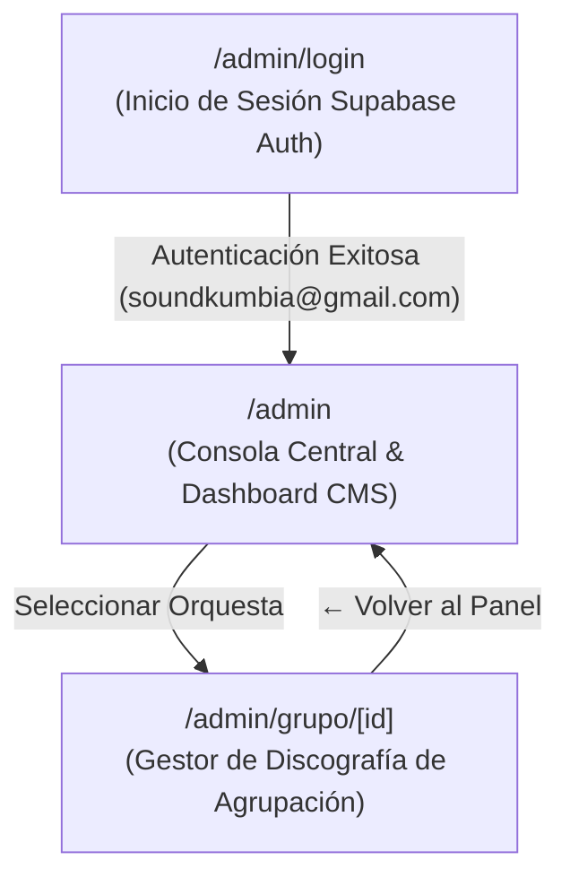

# 04 · Especificación de Estructura y Arquitectura del Panel Admin

> **Propósito:** Describir la arquitectura técnica, jerarquía de pantallas, módulos de gestión, pipeline de imágenes WebP y controles de acceso del panel de administración (`/admin`) de Kumbia Sound.
> **Responde a:**
> - ¿Cómo está estructurado y ordenado el panel de administración?
> - ¿Qué módulos, pestañas y componentes lo integran?
> - ¿Cómo se autentican los administradores y qué permisos tienen?
> - ¿Cómo funciona la subida y optimización de carátulas fotográficas?
> **Fuente principal de:** Estructura de vistas administrativas, formularios de catalogación, pipeline de medios y configuración del CMS.
> **No contiene (ver):**
> - Vistas públicas y expedientes de usuario → [pantallas.md](file:///c:/Users/CACTU/Downloads/Proyectos/cumbia-peruana/docs/04-diseno/pantallas.md)
> - Políticas RLS de base de datos → [seguridad-y-datos.md](file:///c:/Users/CACTU/Downloads/Proyectos/cumbia-peruana/docs/06-calidad/seguridad-y-datos.md)
> - Caso de uso detallado → [flujos-de-usuario.md](file:///c:/Users/CACTU/Downloads/Proyectos/cumbia-peruana/docs/02-requisitos/flujos-de-usuario.md)
> **Estado:** VIGENTE · **Última revisión:** 2026-10-31

---

## 1. Mapa de Navegación del Panel Administrativo

El panel está completamente aislado del frontend público (no existen botones ni enlaces en el menú, cintillo ni pie de página) y se accede únicamente mediante URL directa:



---

## 2. Seguridad y Reglas de Acceso

1. **Rutas Protegidas:** `/admin` y `/admin/grupo/[id]`.
2. **Mecanismo de Guardia (`layout.tsx` / `page.tsx`):**
   - Ejecuta en el servidor `supabase.auth.getUser()`.
   - Si no existe sesión activa o el correo no coincide con el administrador autorizado (`soundkumbia@gmail.com`), redirige inmediatamente por HTTP 307 a `/admin/login`.
3. **Manejo de Sesión:** Cookies seguras HttpOnly gestionadas a través del paquete `@supabase/ssr`.

---

## 3. Arquitectura de Pantallas y Componentes

### 3.1 Consola Central (`/admin`)
Implementada en [`src/app/admin/page.tsx`](file:///c:/Users/CACTU/Downloads/Proyectos/cumbia-peruana/src/app/admin/page.tsx) y coordinada por `AdminTabsContainer`.

#### A. Barra Superior Administrativa
- **Botón Retorno:** Flecha para volver a la portada de la web pública.
- **Identidad:** Título *Panel de Administración* + Insignia verde `[● Autenticado]` con el correo del administrador.
- **Acciones:** Enlace *Ver Web en Vivo* (en nueva pestaña) y botón de cierre de sesión (`LogoutButton`).

#### B. Dashboard de KPIs de Custodia Fotográfica
Cuatro tarjetas métricas con barras de progreso que indican la cobertura de digitalización:
1. **Portadas Álbum:** Total de álbumes con portada / total general en catálogo.
2. **Fotos Grupos:** Agrupaciones con fotografía oficial / total de orquestas.
3. **Fotos Personas:** Pioneros y sesionistas con retrato verificado / total de personas.
4. **Logos Sellos:** Casas discográficas con logotipo restaurado / total de sellos.

#### C. Las 3 Pestañas Principales (`AdminTabsContainer`)

```text
+-----------------------------------------------------------------------------------+
| [ TAB 1: CATÁLOGO & FOTOS ]  |  [ TAB 2: BLOG & CRÓNICAS ]  |  [ TAB 3: PERSONALIZAR HOME ] |
+-----------------------------------------------------------------------------------+
```

1. **Pestaña 1 · Catálogo & Medios (`AdminMediaManager`):**
   - **Sub-pestañas internas:**
     - `Álbumes`: Búsqueda por título o catálogo, filtro por formato (LP, 45 RPM, EP, Casete, CD) y filtro de estado (con imagen / sin imagen). Permite asignar portada, contraportada y galleta.
     - `Grupos`: Listado de agrupaciones con desglose de sus discos catalogados (LPs, Singles, Casetes, EPs, CDs) y botón para abrir su gestor dedicado `/admin/grupo/[id]`.
     - `Personas`: Directorio de músicos y compositores para subir y verificar retratos de archivo.
     - `Sellos`: Inventario de casas discográficas históricas (Infopesa, Discos Horóscopo, Sono Radio, Virrey, Odeón, etc.) para vincular logotipos.
2. **Pestaña 2 · Blog & Crónicas (`AdminBlogManager`):**
   - Gestor de artículos de investigación y ensayos históricos.
   - Listado de notas publicadas y borradores.
   - Editor con campos: Título, Slug URL, Extracto, Contenido Markdown, Autor, Portada, Tiempo de lectura y conmutador `Publicado: Sí/No`.
3. **Pestaña 3 · Personalización de la Portada (`AdminHomeConfig`):**
   - Interfaz visual para modificar en tiempo real la tabla `configuracion_home`.
   - Campos configurables:
     - Texto del cintillo superior y conmutador de activación.
     - Insignia, Título y Subtítulo del Hero Monumental.
     - Texto y destino del botón principal de llamada a la acción (CTA).
     - Selección de los 3 álbumes destacados en la sección *Obra Destacada*.
     - Activación o desactivación de la sección pública de blog.

---

### 3.2 Gestor Detallado de Agrupación (`/admin/grupo/[id]`)
Implementada en [`src/app/admin/grupo/[id]/page.tsx`](file:///c:/Users/CACTU/Downloads/Proyectos/cumbia-peruana/src/app/admin/grupo/%5Bid%5D/page.tsx) y [`admin-group-detail.tsx`](file:///c:/Users/CACTU/Downloads/Proyectos/cumbia-peruana/src/features/admin/components/admin-group-detail.tsx).

* **Propósito:** Trabajar a profundidad la discografía completa de una orquesta en particular (ej. Grupo Celeste, Los Destellos, Juaneco y su Combo).
* **Funcionalidades:**
  - Foto de la agrupación (con previsualización y reemplazo).
  - Filtro por formatos de audio (Todos, LPs, 45 RPM, Casetes, EPs, CDs).
  - Filtro por completitud de imágenes: *Todos*, *Con Portada*, *Sin Portada*.
  - Tarjetas de álbum con subida diferenciada de:
    - **Cara A / Portada (`url_portada`).**
    - **Cara B / Contraportada (`url_contraportada`).**
    - **Galleta Central (`url_etiqueta`).**

---

## 4. Pipeline de Procesamiento de Imágenes WebP (`ImageUploader`)

Por directiva de rendimiento (`DEC-004` y `RF-009`), la subida de imágenes en el panel admin no satura el servidor de Next.js:


---

## 5. Índice de Archivos Fuente del Panel Admin

| Archivo | Ruta | Responsabilidad |
| :--- | :--- | :--- |
| **Shell & Layout** | [`src/app/admin/layout.tsx`](file:///c:/Users/CACTU/Downloads/Proyectos/cumbia-peruana/src/app/admin/layout.tsx) | Envoltura de páginas administrativas. |
| **Consola Principal** | [`src/app/admin/page.tsx`](file:///c:/Users/CACTU/Downloads/Proyectos/cumbia-peruana/src/app/admin/page.tsx) | Verificación de auth, carga paralela de datos y KPIs. |
| **Login** | [`src/app/admin/login/page.tsx`](file:///c:/Users/CACTU/Downloads/Proyectos/cumbia-peruana/src/app/admin/login/page.tsx) | Formulario de autenticación con Supabase Auth. |
| **Detalle de Grupo** | [`src/app/admin/grupo/[id]/page.tsx`](file:///c:/Users/CACTU/Downloads/Proyectos/cumbia-peruana/src/app/admin/grupo/%5Bid%5D/page.tsx) | Vista de auditoría y subida de carátulas por orquesta. |
| **Contenedor Tabs** | [`src/features/admin/components/admin-tabs-container.tsx`](file:///c:/Users/CACTU/Downloads/Proyectos/cumbia-peruana/src/features/admin/components/admin-tabs-container.tsx) | Selector de pestañas: Catálogo, Blog y Personalizar Home. |
| **Gestor de Medios** | [`src/features/admin/components/admin-media-manager.tsx`](file:///c:/Users/CACTU/Downloads/Proyectos/cumbia-peruana/src/features/admin/components/admin-media-manager.tsx) | Filtros y asignación de imágenes a álbumes, grupos y sellos. |
| **Gestor de Blog** | [`src/features/admin/components/admin-blog-manager.tsx`](file:///c:/Users/CACTU/Downloads/Proyectos/cumbia-peruana/src/features/admin/components/admin-blog-manager.tsx) | CRUD de artículos y crónicas históricas. |
| **Configurador Home** | [`src/features/admin/components/admin-home-config.tsx`](file:///c:/Users/CACTU/Downloads/Proyectos/cumbia-peruana/src/features/admin/components/admin-home-config.tsx) | Editor de textos, hero y destacados de la portada. |
| **Uploader WebP** | [`src/features/storage/components/image-uploader.tsx`](file:///c:/Users/CACTU/Downloads/Proyectos/cumbia-peruana/src/features/storage/components/image-uploader.tsx) | Pipeline Canvas API para compresión WebP en cliente. |
