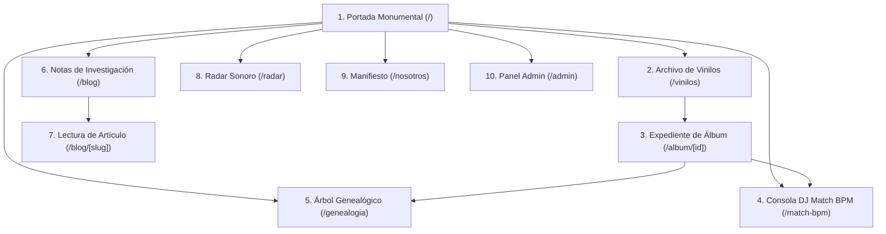

# 04 · Especificación de Pantallas y Vistas de Interfaz

> **Propósito:** Definir la arquitectura de regiones, jerarquía de componentes, datos presentados, estados de carga/error y comportamiento responsive para cada una de las pantallas de Kumbia Sound.
> **Responde a:**
> - ¿Qué componentes, wireframes textuales y jerarquías estructuran cada vista del sistema?
> - ¿Qué campos del modelo relacional se renderizan en cada región de pantalla?
> - ¿Cómo responden las vistas ante estados de carga (`loading.tsx`), error (`error.tsx`) o registros vacíos?
> - ¿Qué requisitos funcionales (`RF-NNN`) y casos de uso (`UC-NNN`) respaldan cada pantalla?
> **Fuente principal de:** Estructura de vistas, wireframes textuales, estados de interacción por pantalla y mapas de navegación.
> **No contiene (ver):**
> - Tokens de color, tipografía y componentes base → [sistema-visual.md](file:///c:/Users/CACTU/Downloads/Proyectos/cumbia-peruana/docs/04-diseno/sistema-visual.md)
> - Requisitos funcionales y de negocio → [requisitos.md](file:///c:/Users/CACTU/Downloads/Proyectos/cumbia-peruana/docs/02-requisitos/requisitos.md)
> - Flujos paso a paso de tareas de usuario → [flujos-de-usuario.md](file:///c:/Users/CACTU/Downloads/Proyectos/cumbia-peruana/docs/02-requisitos/flujos-de-usuario.md)
> **Depende de:**
> - [sistema-visual.md](file:///c:/Users/CACTU/Downloads/Proyectos/cumbia-peruana/docs/04-diseno/sistema-visual.md)
> - [modelo-de-datos.md](file:///c:/Users/CACTU/Downloads/Proyectos/cumbia-peruana/docs/03-arquitectura/modelo-de-datos.md)
> - [requisitos.md](file:///c:/Users/CACTU/Downloads/Proyectos/cumbia-peruana/docs/02-requisitos/requisitos.md)
> **Entregar a otra IA para:** Rediseñar wireframes, implementar nuevas vistas de consulta o validar la consistencia de la experiencia de usuario.
> **Estado:** VIGENTE · **Última revisión:** 2026-10-31 · **Describe la versión:** commit 04ef58c

---

## 1. Mapa General de Navegación y Vistas



---

## 2. Especificación Detallada por Pantalla

### 2.1 Portada Monumental (`/`)
* **Ruta:** `/`
* **Propósito:** Impacto editorial inmediato, posicionamiento del archivo desclasificado y acceso directo a las herramientas periciales y expedientes destacados.
* **Componentes Utilizados:** `BrutalistTopBar`, `BrutalistHero`, `BrutalistSelectedWork`, `BrutalistTriptych`, `BrutalistGenresSection`, `BrutalistStories`, `BrutalistFooter`.
* **Requisitos Vinculados:** `RF-001`, `RF-002`, `RF-007`.

#### Wireframe Textual
```text
+-----------------------------------------------------------------------------------+
| [TOP BAR] ARCHIVO FONOGRÁFICO // 721 EXPEDIENTES // LIMA-PERÚ       [BUSCADOR ⌘K] |
+-----------------------------------------------------------------------------------+
| [HERO MONUMENTAL]                                                                 |
| KUMBIA SOUND · ARCHIVO DESCLASIFICADO 1968-2005                                    |
| [Subtítulo Editorial] Metadatos periciales, prensajes en vinilo y genealogía      |
| [CTA Primario: AUDITAR EXPEDIENTES] [CTA Secundario: CONSOLA MATCH BPM]          |
+-----------------------------------------------------------------------------------+
| [TRÍPTICO EDITORIAL]                                                              |
| [EXP. 01: VINILOS]        | [EXP. 02: GENEALOGÍA]       | [EXP. 03: MATCH BPM]    |
| 721 producciones físicas  | Músicos y seudónimos        | Armonía y rueda Camelot |
+-----------------------------------------------------------------------------------+
| [OBRA DESTACADA // EXPEDIENTE DEL MES]                                            |
| [Arte Portada WebP 1:1]   | Título, Agrupación, Sello, Año, Prensaje original     |
|                           | [Tracklist Lado A/B] [Botón Explorar Álbum]           |
+-----------------------------------------------------------------------------------+
| [SECCIÓN VERTIENTES SONORAS]                                                      |
| Costeña / Psicodélica · Amazónica · Chicha y Andina · Norteña Orquestal           |
+-----------------------------------------------------------------------------------+
| [FOOTER INSTITUCIONAL] Manifiesto Patrimonial · Sin fines de lucro · 1968-2005    |
+-----------------------------------------------------------------------------------+
```

---

### 2.2 Archivo General de Vinilos (`/vinilos`)
* **Ruta:** `/vinilos`
* **Propósito:** Exploración y filtrado pericial de la colección completa de discos prensados (LPs, Singles, EPs, Casetes, CDs).
* **Componentes Utilizados:** `BrutalistTopBar`, `FormatFilterBar`, `VinylGrid`, `AlbumCard`, `BrutalistPagination`.
* **Datos Mostrados:** `Albumes.nombre_album`, `Albumes.año_publicacion`, `Albumes.numero_catalogo`, `Grupos.nombre_grupo`, `Sellos_Discograficos.nombre_sello`, `Tipos_Album.nombre_tipo`.
* **Estados:**
  - *Carga (`loading.tsx`):* Grilla de 12 tarjetas esqueleto con borde de 2px y pulso suave.
  - *Vacío:* Sello pericial: `[EXPEDIENTES NO LOCALIZADOS // AJUSTAR FILTRO DE MATRIZ]`.
* **Requisitos Vinculados:** `RF-001`, `RF-008`, `UC-001`.

---

### 2.3 Ficha Pericial de Álbum y Vinilo (`/album/[id]`)
* **Ruta:** `/album/[id]`
* **Propósito:** Expediente maestro de una producción fonográfica con auditoría de surcos físicos, galleta central, créditos por pista y vínculos genealógicos.
* **Componentes Utilizados:** `AlbumHeroPericial`, `VinylSpinner`, `FolderTabs` (Lado A / Lado B), `AlbumTracklistTable`, `CompositorCreditsBadge`.
* **Datos Mostrados:**
  - Cabecera: `nombre_album`, `año_publicacion`, `numero_catalogo`, `codigo_matriz`, `url_portada`, `url_contraportada`, `url_etiqueta`.
  - Pistas: `numero_pista`, `lado` (estrictamente A o B), `titulo_tema`, `duracion_segundos`, `bpm`, `camelot_code`, compositores y sesionistas.
* **Requisitos Vinculados:** `RF-001`, `RF-002`, `RF-003`, `INV-001`, `INV-002`, `UC-001`.

#### Wireframe Textual
```text
+-----------------------------------------------------------------------------------+
| <- VOLVER A EXPEDIENTES // EXP-LP-014 // CLASIFICACIÓN PÚBLICA                    |
+-----------------------------------------------------------------------------------+
| [COLUMNA IZQUIERDA: ARTE]          | [COLUMNA DERECHA: EXPEDIENTE TÉCNICO]        |
| [Portada WebP 500x500px]           | GRUPO CELESTE · "EL HIJO DE NADIE" (1975)    |
| [Sello: PRENSAJE MATRIZ ORIGINAL]  | Sello: Discos Horóscopo // Cat: HLS-001      |
| [Galleta Vinilo Giratoria]         | Prensaje: Lima, Perú // Formato: LP 33 RPM   |
| [Ver Contraportada]                | Director: Víctor Casahuamán Bendezú          |
+-----------------------------------------------------------------------------------+
| [PESTAÑAS DE CARPETA FUSIÓN ARCHIVADORA]                                          |
| +-------------------------+-------------------------+                             |
| | === LADO A (6 SURCOS) === |     LADO B (6 SURCOS)   |                             |
+-----------------------------------------------------------------------------------+
| PISTA | TÍTULO DEL TEMA       | COMPOSITOR (GALLETA) | VOZ / INSTRUMENTOS | DUR  | CAM |
|-------+-----------------------+----------------------+--------------------+------+-----|
| A1    | El Hijo de Nadie      | V. Casahuamán (D.R.) | Chacalón (Voz)     | 3:24 | 8A  |
| A2    | Viento                | V. Casahuamán        | Chacalón (Voz)     | 3:15 | 9B  |
| A3    | En Mil Pedazos        | Manuel Casahuamán    | Chacalón (Voz)     | 2:58 | 7A  |
+-----------------------------------------------------------------------------------+
```

---

### 2.4 Consola DJ Match BPM & Rueda Camelot (`/match-bpm`)
* **Ruta:** `/match-bpm`
* **Propósito:** Herramienta interactiva para DJs e investigadores que calcula transiciones armónicas compatibles sobre el archivo de canciones catalogadas.
* **Componentes Utilizados:** `CamelotWheelSVG`, `BpmToleranceSlider`, `CompatibleTracksTable`, `PitchShiftIndicator`.
* **Interacciones:**
  - Clic en cualquier sector de la rueda Camelot (`1A` a `12B`) para seleccionar tonalidad base.
  - Ajuste del slider de BPM (±0 % a ±8 %).
  - Filtrado en tiempo real de canciones sin recargar la página.
* **Requisitos Vinculados:** `RF-004`, `RF-005`, `INV-004`, `UC-002`.

---

### 2.5 Explorador del Árbol Genealógico (`/genealogia`)
* **Ruta:** `/genealogia`
* **Propósito:** Navegación en red de directores, sesionistas clandestinos (`credito_como`) y árboles de versiones sucesivas de obras musicales.
* **Componentes Utilizados:** `MusicianSearchInput`, `GenealogyTreeGraph`, `VersionesExplorerModal`, `SessionistTimeline`.
* **Datos Mostrados:** Obtenidos mediante los procedimientos almacenados `get_arbol_genealogico` y `get_genealogia_versiones`.
* **Requisitos Vinculados:** `RF-002`, `RF-003`, `DEC-003`, `UC-003`.

---

### 2.6 Panel de Administración Fonográfica (`/admin`)
* **Ruta:** `/admin`, `/admin/login`, `/admin/grupo/[id]`
* **Propósito:** Gestión autenticada de expedientes, vinculación de grabaciones de sesión y carga de portadas WebP.
* **Componentes Utilizados:** `AdminHeader`, `LoginForm`, `CatalogEditorForm`, `ImageUploader` (con Canvas WebP pipeline).
* **Restricción de Acceso:** Requiere sesión activa de Supabase Auth con rol administrativo; de lo contrario redirige a `/admin/login`.
* **Requisitos Vinculados:** `RF-006`, `RF-009`, `DEC-004`, `UC-004`.

---

## 3. Actualizar Cuando

- Se agregue o modifique una vista o subpágina en `src/app/`.
- Se rediseñe la disposición de regiones en la ficha de álbum o la consola DJ.
- Se incorporen nuevas interacciones o filtros de catálogo.
