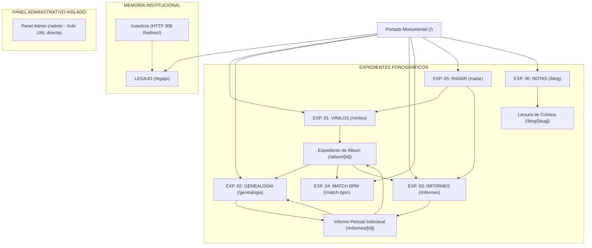

# 04 · Especificación de Pantallas y Vistas de Interfaz

> **Propósito:** Definir la arquitectura de regiones, jerarquía de componentes, datos presentados, estados de carga/error y comportamiento responsive para cada una de las pantallas de Kumbia Sound.
> **Responde a:**
> - ¿Qué componentes, wireframes textuales y jerarquías estructuran cada vista del sistema?
> - ¿Qué campos del modelo relacional se renderizan en cada región de pantalla?
> - ¿Cómo responden las vistas ante estados de carga (`loading.tsx`), error (`error.tsx`) o registros vacíos?
> - ¿Qué requisitos funcionales (`RF-NNN`) y casos de uso (`UC-NNN`) respaldan cada pantalla?
> **Fuente principal de:** Estructura de vistas, wireframes textuales, estados de interacción por pantalla y mapas de navegación.
> **No contiene (ver):**
> - Tokens de color, tipografía y componentes base → [sistema-visual.md](file:///c:/Users/CACTU/Downloads/Proyectos/cumbia-peruana/docs/04-diseno/sistema-visual.md)
> - Requisitos funcionales y de negocio → [requisitos.md](file:///c:/Users/CACTU/Downloads/Proyectos/cumbia-peruana/docs/02-requisitos/requisitos.md)
> - Flujos paso a paso de tareas de usuario → [flujos-de-usuario.md](file:///c:/Users/CACTU/Downloads/Proyectos/cumbia-peruana/docs/02-requisitos/flujos-de-usuario.md)
> **Depende de:**
> - [sistema-visual.md](file:///c:/Users/CACTU/Downloads/Proyectos/cumbia-peruana/docs/04-diseno/sistema-visual.md)
> - [modelo-de-datos.md](file:///c:/Users/CACTU/Downloads/Proyectos/cumbia-peruana/docs/03-arquitectura/modelo-de-datos.md)
> - [requisitos.md](file:///c:/Users/CACTU/Downloads/Proyectos/cumbia-peruana/docs/02-requisitos/requisitos.md)
> **Entregar a otra IA para:** Rediseñar wireframes, implementar nuevas vistas de consulta o validar la consistencia de la experiencia de usuario.
> **Estado:** VIGENTE · **Última revisión:** 2026-10-31 · **Describe la versión:** reorganización canónica de 7 secciones (rama feat/reorganizacion-secciones-expedientes)

---

## 1. Mapa Canónico de Navegación y Expedientes

La arquitectura pública de Kumbia Sound se estructura bajo el concepto de **Archivo Desclasificado** en 7 secciones canónicas estrictamente ordenadas, con aislamiento absoluto del panel administrativo:

> **Aislamiento del Panel Admin:** Por directiva de arquitectura editorial, ningún enlace público a `/admin` aparece en la Portada, TopBar, Navbar o Footer. El panel permanece operativo exclusivamente para administradores autenticados mediante acceso directo por URL.

---

## 2. Especificación Detallada por Pantalla

### 2.1 Portada Monumental (`/`)
* **Ruta:** `/`
* **Propósito:** Entrada al archivo patrimonial desclasificado. Jerarquía tipográfica neo-brutalista, buscador global (⌘K) y acceso directo a las 7 secciones canónicas.
* **Componentes:** `BrutalistTopBar`, `BrutalistHero`, `BrutalistSelectedWork`, `BrutalistTriptych`, `BrutalistGenresSection`, `BrutalistStories`, `BrutalistFooter`.
* **Requisitos:** `RF-001`, `RF-002`, `RF-007`.

---

### 2.2 EXP. 01: Archivo General de Vinilos (`/vinilos`)
* **Ruta:** `/vinilos`
* **Propósito:** Bóveda de custodia analógica de prensajes en vinilo (LPs 33 RPM y Singles 45 RPM). Filtros por década, formato, sellos discográficos históricos y ordenación por catálogo.
* **Componentes:** `VinilosCatalogExplorer`, `AlbumCard`, `BrutalistCoordinator`.
* **Vínculos:** Enlace a `/album/[id]`.

---

### 2.3 Expediente de Álbum y Prensaje (`/album/[id]`)
* **Ruta:** `/album/[id]`
* **Propósito:** Auditoría física del disco de vinilo. Portada y contraportada restauradas, galleta central, Lado A y Lado B estrictos (`INV-001`), créditos aislados de autoría (`INV-004`) y enlace a los informes de cada músico participante.
* **Componentes:** `AlbumHeroPericial`, `VinylSpinner`, `AlbumTracklistTable`, `BadgeDJ`.

---

### 2.4 EXP. 02: Genealogía Fonográfica (`/genealogia`)
* **Ruta:** `/genealogia`
* **Propósito:** Mapa de conexiones, linajes y relaciones entre entidades (no fichas personales aisladas).
* **Estructura en 3 Carpetas Fusionadas:**
  1. **Carpeta 01 · AGRUPACIONES (`AGR-001`...):** Evolución histórica de las orquestas, cambios cronológicos de directores y vocalistas principales (ej. Grupo Celeste: etapa Casahuamán / Chacalón vs etapa posterior).
  2. **Carpeta 02 · VERSIONES:** Árbol recursivo de grabaciones, covers y re-grabaciones (`WITH RECURSIVE` en Postgres).
  3. **Carpeta 03 · RED DE MÚSICOS:** Visualizador relacional de sesionistas compartidos. Al hacer clic en un músico, conduce obligatoriamente a su expediente en `/informes/[id]`.
* **Componentes:** `GenealogiaContainer`, `TabAgrupaciones`, `TabVersiones`, `TabRedMusicos`.

---

### 2.5 EXP. 03: Informes Periciales de Músicos (`/informes` y `/informes/[id]`)
* **Rutas:** `/informes` (índice pericial) y `/informes/[id]` (expediente de UN músico).
* **Propósito:** Ficha biográfica, identidad civil y trayectoria fonográfica de cada músico (`INF-0001`, `INF-0002`...).
* **Sello de Verificación Pericial:**
  - `[FUENTE PRIMARIA]`: Cotejado con galletas originales, matrices y registros notariales.
  - `[FUENTE SECUNDARIA]`: Reconstruido a partir de discografías secundarias, prensa y entrevistas.
  - `[SIN VERIFICAR]`: Registro documental preliminar.
* **Contenido de la Ficha:**
  - Retrato pericial con marco brutalista.
  - Nombre completo, apodo/seudónimo oficial, lugar y fecha de nacimiento.
  - Declaración pericial biográfica.
  - Tabla automática de **Agrupaciones Integradas** (con rol y fechas).
  - Tabla automática de **Pistas Grabadas como Sesionista** (con instrumento, crédito y enlace al vinilo en `/album/[id]`).
  - Tabla automática de **Composiciones Catalogadas** (con BPM, Camelot y versiones).
* **Componentes:** `InformesGrid`, `InformeCard`, `InformeDetailView`.

---

### 2.6 EXP. 04: Match BPM & Planilla de Mezcla (`/match-bpm`)
* **Ruta:** `/match-bpm`
* **Propósito:** Consola técnica para DJs de vinilo y tornamesistas. Búsqueda por BPM y tonalidad armónica en la Rueda Camelot (`1A`–`12B`).
* **Subfunción Planilla de Mezcla:** Secuenciador a dos tornamesas para planificar, reordenar y exportar setlists sin reproducir audio local (`INV-005`).
* **Componentes:** `CreaTuMix`, `MatchBpmWidget`, `CamelotSelector`.

---

### 2.7 EXP. 05: Radar Sonoro (`/radar`)
* **Ruta:** `/radar`
* **Propósito:** El hallazgo mensual que alimenta a la comunidad. Vitrina de descubrimiento fonográfico.
* **Estructura Fija de 4 Puntos:**
  1. **Qué es:** Categoría canónica (Álbum del Mes / Voz Rescatada / Agrupación Olvidada / Subgénero a Descubrir).
  2. **Por qué importa:** Ficha breve con el valor patrimonial e histórico.
  3. **Escúchalo:** Enlaces oficiales externos a YouTube y Spotify (sin distribución de audio en servidor, respetando `INV-005`).
  4. **Explóralo:** Vínculo al expediente del disco en `/vinilos` o al informe en `/informes`.
* **Historial de Hallazgos:** Colección cronológica navegable de fichas de meses anteriores.
* **Componentes:** `HallazgoDelMes`, `HistorialHallazgos`, `RadarSonoro`.

---

### 2.8 EXP. 06: Notas de Investigación (`/blog` y `/blog/[slug]`)
* **Rutas:** `/blog` y `/blog/[slug]`
* **Propósito:** Artículos extensos, crónicas de época, historia de sellos matrices e investigaciones metodológicas sobre el archivo fonográfico.
* **Componentes:** `ArticleCard`, `ArticleHeader`, `ArticleContent`.

---

### 2.9 LEGAJO Institucional (`/legajo`)
* **Ruta:** `/legajo` (con redirección permanente desde `/nosotros`).
* **Propósito:** Marco institucional del colectivo patrimonial Kumbia Sound (anterior a la web).
* **5 Apartados Obligatorios:**
  1. **Acta Fundacional:** Manifiesto patrimonial con la declaración explícita de que el colectivo de investigación y coleccionismo precede al desarrollo de la web.
  2. **Equipo de Peritaje:** Nómina de peritos fonográficos, digitalizadores de matrices y catalogadores.
  3. **Normas de Catalogación:** Las 6 reglas estrictas del archivo (Lados A/B, tratamiento de mosaicos, aislamiento de la columna VOZ, notación Camelot pura, duraciones a segundos enteros, prevalencia de fuentes primarias).
  4. **Solicitud de Rectificación:** Procedimiento riguroso de cotejo pericial en 3 pasos (solicitud fundamentada con foto de galleta matriz o registro notarial).
  5. **Contacto & Canales Oficiales:** Correo de peritaje y enlaces a la Fonoteca Oficial en YouTube y Master en Spotify.

---

## 3. Matriz de Componentes y Vínculos de Modelo

| Pantalla | Código Exp. | Entidad Relacional Principal | Componentes Core | Vínculos Salientes |
| :--- | :--- | :--- | :--- | :--- |
| **Vinilos** | `EXP. 01` | `Albumes`, `Sellos_Discograficos` | `VinilosCatalogExplorer` | `/album/[id]` |
| **Genealogía** | `EXP. 02` | `Grupos`, `Grupos_Musicos`, `Versiones` | `GenealogiaContainer` | `/informes/[id]`, `/vinilos` |
| **Informes** | `EXP. 03` | `Personas`, `Tema_Musicos`, `Temas_Compositores` | `InformesGrid`, `InformeDetailView` | `/album/[id]`, `/genealogia` |
| **Match BPM** | `EXP. 04` | `Temas` (`bpm`, `camelot_code`) | `CreaTuMix`, `CamelotSelector` | Exportación de Setlist |
| **Radar** | `EXP. 05` | Curaduría Mensual | `HallazgoDelMes`, `HistorialHallazgos` | `/vinilos`, `/informes`, YouTube/Spotify |
| **Notas** | `EXP. 06` | `Articulos` | `ArticleCard`, `ArticleContent` | `/blog/[slug]` |
| **Legajo** | `LEGAJO` | Institucional / Colectivo | Apartados 1 a 5 | Canales oficiales, Rectificaciones |
