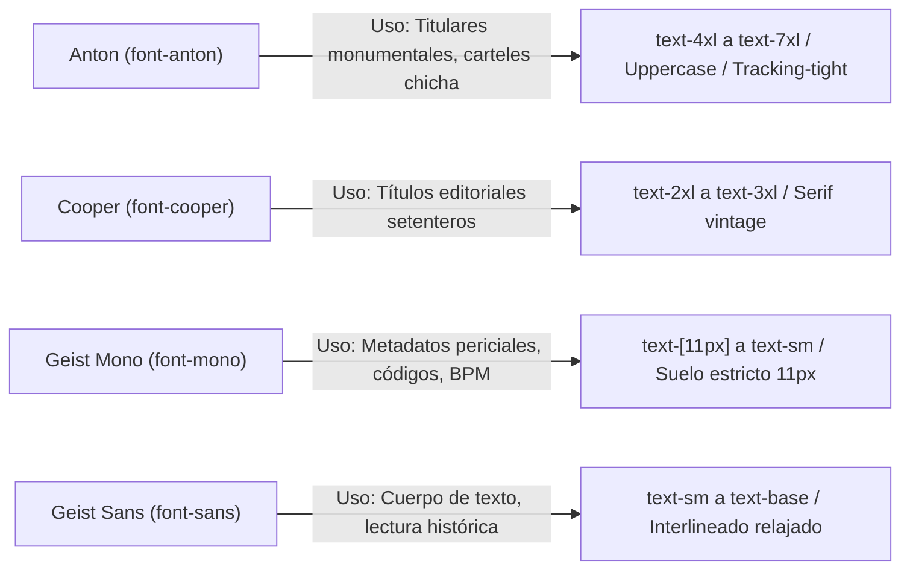

# 04 · Sistema de Diseño Neo-Brutalista Editorial y Tokens Visuales

> **Propósito:** Especificar de forma exhaustiva la identidad visual, tokens de diseño en CSS/Tailwind v4, componentes periciales y reglas de accesibilidad de Kumbia Sound.
> **Responde a:**
> - ¿Cuáles son los valores hexadecimales exactos de la paleta y qué rol semántico cumple cada uno?
> - ¿Qué familias tipográficas, escalas y reglas de jerarquía rigen los titulares y metadatos periciales?
> - ¿Cómo se componen los componentes visuales característicos (tarjeta de expediente, sellos de caucho, rueda Camelot, pestañas fusión)?
> - ¿Cómo está implementado el sistema de tokens en `globals.css` y qué se requiere para migrar de estilo visual?
> **Fuente principal de:** Tokens de diseño (color, tipografía, bordes, sombras), recetas de componentes UI, reglas de contraste y accesibilidad.
> **No contiene (ver):**
> - Estructura de regiones y comportamiento por pantalla → [pantallas.md](file:///c:/Users/CACTU/Downloads/Proyectos/cumbia-peruana/docs/04-diseno/pantallas.md)
> - Requisitos funcionales asociados a la interfaz → [requisitos.md](file:///c:/Users/CACTU/Downloads/Proyectos/cumbia-peruana/docs/02-requisitos/requisitos.md)
> - Capas de software y clientes Next.js → [arquitectura.md](file:///c:/Users/CACTU/Downloads/Proyectos/cumbia-peruana/docs/03-arquitectura/arquitectura.md)
> **Depende de:**
> - [glosario.md](file:///c:/Users/CACTU/Downloads/Proyectos/cumbia-peruana/docs/01-proyecto/glosario.md)
> - [requisitos.md](file:///c:/Users/CACTU/Downloads/Proyectos/cumbia-peruana/docs/02-requisitos/requisitos.md)
> **Entregar a otra IA para:** Rediseñar la interfaz, auditar contrastes WCAG, migrar a un nuevo tema visual o programar nuevos componentes UI consistentes.
> **Estado:** VIGENTE · **Última revisión:** 2026-10-31 · **Describe la versión:** commit 04ef58c

---

## 1. Identidad Visual y Filosofía Narrativa

Kumbia Sound no implementa un diseño web genérico ni una interfaz SaaS contemporánea de bordes redondeados y fondos oscuros difusos (*dark glassmorphism*).

La identidad estética responde a la metáfora de un **Archivo Pericial Nacional y Fonográfico (1968–2005) desclasificado al público**:
- Los álbumes prensados son **evidencias físicas bajo custodia**.
- Las subpáginas son **expedientes documentales** (`EXP. 01` a `EXP. 06`).
- Cada pista sonora es un **corte de surco analógico**.
- Las herramientas interactivas (Match BPM, Rueda Camelot, Consola DJ) se presentan como **maquinaria de peritaje y hardware de estudio**.
- El usuario consulta legajos, verifica estampados de matriz y examina galletas de vinilo.

### 1.1 Principios Rectores Inquebrantables

1. **Tangibilidad Analógica:** Todo elemento evoca papel manila envejecido, cartulina de legajo, tinta de imprenta tipográfica, vinilo físico y sellos de caucho.
2. **Geometría 100% Ortogonal (`rounded-none`):** Queda prohibido el uso de esquinas redondeadas (`rounded-lg`, `rounded-xl`, `rounded-full`) en contenedores estructurales, tarjetas y botones. Los marcos son rectos y definidos por bordes sólidos de `2px`.
3. **Física Mecánica Coherente de Sombras:**
   - La fuente de luz proviene siempre de la esquina superior izquierda (`top-left`).
   - Las sombras caen rígidamente hacia abajo y la derecha (`+X, +Y`) sin desenfoque (`blur: 0`): `box-shadow: 4px 4px 0 #1F1305`.
   - En estado activo (`active`), el botón se presiona contra el papel (`translate-x-[2px] translate-y-[2px]`).
4. **Suelo Tipográfico Mínimo de 11px:** Prohibición absoluta de textos microscópicos (`8px` o `9px`). Todo dato técnico tiene como límite inferior `text-[11px]` en `font-mono`.
5. **Colores Sólidos sin Opacidades Fantasma:** Prohibidas las transparencias bajas arbitrarias (`/10`, `/15`). Cada superficie debe mantener contraste y nitidez de lectura.
6. **Desambiguación Semántica del Rojo:** El color rojo (`#E80000`) se reserva exclusivamente para sellos periciales confidenciales, alertas críticas y pitch frenado. Los BPM se imprimen en tinta negra neutra (`#1F1305`).
7. **Pestañas Fusión Archivadoras:** Las barras de navegación simulan carpetas físicas donde la pestaña activa se fusiona sin línea divisoria con el cuerpo del expediente.

---

## 2. Tokens Canónicos de Diseño

Valores exactos extraídos y sincronizados con [`src/app/globals.css`](file:///c:/Users/CACTU/Downloads/Proyectos/cumbia-peruana/src/app/globals.css):

### 2.1 Tokens de Color

| Token Tailwind / CSS | Hex / Valor | Rol Semántico | Uso Permitido | Uso Prohibido | Contraste (WCAG) |
| :--- | :--- | :--- | :--- | :--- | :--- |
| `--color-brutalist-cream` | `#EDE0D0` | Fondo Global Papel | Fondo maestro de la página y modal base. | Texto principal sobre fondo blanco. | Base fondo |
| `--color-brutalist-black` | `#1F1305` | Tinta Espresso Imprenta | Texto principal, bordes de 2px, sombras rígidas. | Fondos de grandes áreas de lectura clara. | 14.8:1 sobre cream (AAA) |
| `--color-brutalist-white` | `#FFFFFF` | Cartulina Blanca Pura | Fondo de portadas, galletas y áreas de alto realce. | Fondo de toda la pantalla (debe ser cream). | - |
| `--color-brutalist-orange`| `#F1730C` | Naranja Radiactivo | Botones de acción primaria, badges activos, acentos. | Texto corrido en párrafos extensos. | 3.5:1 (UI componente) |
| `--color-logo-red` | `#E80000` | Rojo Sello de Caucho | Sellos "DESCLASIFICADO", alertas y focos accesibles. | Fondos de tablas o texto neutral. | 4.8:1 sobre cream (AA) |
| `--color-ink-faded` | `#665D4F` | Sepia Desvanecido | Fechas, códigos de catálogo secundarios, notas al pie. | Títulos o advertencias críticas. | 5.2:1 sobre cream (AA) |
| `--color-border-leather` | `#3E2C1B` | Cuero de Archivo | Bordes de tarjetas secundarias y acentos oscuros. | Fondos globales. | - |
| `--color-gold-solar` | `#F59E0B` | Ámbar Rueda Camelot | Tonos mayores de Camelot (claves A) y estrellas. | Botones de cierre o descarte. | - |
| `--color-chicha-green` | `#10B981` | Verde Rueda Camelot | Tonos menores de Camelot (claves B) y éxito. | Alertas destructivas. | - |
| `--color-pitch-red` | `#C91D1D` | Rojo Freno Pitch | Indicadores de reducción de velocidad BPM (-%). | Indicadores de aumento de BPM. | - |

### 2.2 Sistema Tipográfico



| Escala / Clase | Tamaño | Peso | Interlineado | Tracking | Familia | Rol Semántico |
| :--- | :--- | :--- | :--- | :--- | :--- | :--- |
| `text-display` | `3.5rem - 4.5rem` | `900` | `0.9` | `tracking-tight` | `Anton` | Títulos monumentales de cabecera. |
| `text-h1` | `2.25rem - 3rem` | `800` | `1.0` | `tracking-tight` | `Anton` | Nombre de álbum y agrupación principal. |
| `text-h2` | `1.5rem - 1.875rem`| `700` | `1.2` | `normal` | `Cooper` | Títulos de secciones de expediente. |
| `text-body` | `0.875rem - 1rem` | `400` | `1.5` | `normal` | `Geist Sans` | Texto de lectura, artículos de blog, bios. |
| `text-meta` | `0.6875rem (11px)` | `600` | `1.3` | `tracking-wider`| `Geist Mono`| BPM, código de matriz, lado A/B, duraciones. |

### 2.3 Bordes, Sombras y Elevaciones

- **Grosor Estándar:** `2px` sólido en color Tinta Espresso (`#1F1305`). Clases utilitarias: `.brutalist-border`, `.brutalist-border-t`, `.brutalist-border-b`.
- **Sombra Rígida de Tarjeta (Desktop):** `box-shadow: 4px 4px 0 #1F1305;`
- **Sombra Rígida de Tarjeta (Móvil):** `box-shadow: 2px 2px 0 #1F1305;`
- **Sombra Rígida de Modal (Búnker):** `box-shadow: 8px 8px 0 #1F1305;`
- **Pulsación Mecánica (Active):** `transform: translate(2px, 2px); box-shadow: 2px 2px 0 #1F1305;`

### 2.4 Patrones de Fondo y Texturas

- **Retícula de Puntos Tinta (`.brutalist-dots-light`):**
  `background-image: radial-gradient(#1f1305 1px, transparent 1px); background-size: 16px 16px;`
- **Retícula de Puntos Búnker Oscuro (`.brutalist-dots-dark`):**
  `background-image: radial-gradient(rgba(237, 224, 208, 0.22) 1px, transparent 1px); background-size: 16px 16px;`
- **Surcos de Vinilo (`.vinyl-grooves`):**
  `repeating-radial-gradient(circle at center, rgba(237, 224, 208, 0.07) 0, rgba(237, 224, 208, 0.07) 2px, transparent 3px, transparent 6px)`

---

## 3. Catálogo de Componentes Periciales

### 3.1 Tarjeta de Expediente de Álbum (`AlbumCard`)
- **Estructura:** Contenedor con `border-2 border-[#1F1305]`, fondo `#F8F3EA`, `rounded-none`.
- **Ceja Superior:** Franja con código de evidencia (`EXP-LP-042`) y año de prensaje en tipografía mono.
- **Imagen 1:1:** Portada en WebP con borde inferior divisor de 2px.
- **Interacción Hover:** La tarjeta se eleva (`-translate-y-1 -translate-x-1`), incrementando la sombra rígida a `6px 6px 0 #1F1305`, asomando la galleta de vinilo por el borde derecho.

### 3.2 Sellos de Caucho Periciales (`RubberStamp`)
- **Estilo:** Borde doble de `2px` en color rojo `#E80000`, padding ajustado, tipografía `font-anton` en mayúsculas.
- **Inclinación:** Rotación estática calculada mediante CSS (`transform: rotate(-3deg)` o `rotate(4deg)`).
- **Textos Válidos:** `[DESCLASIFICADO]`, `[EXPEDIENTE BAJO CUSTODIA]`, `[PRENSAJE MATRIZ ORIGINAL]`.

### 3.3 Pestañas de Carpeta Fusión (Selector Lado A / Lado B)
- **Concepto:** Carpetas archivadoras físicas de cartón.
- **Pestaña Activa:** Fondo idéntico al contenedor inferior (`#F8F3EA`), borde superior e izquierdo/derecho de `2px solid #1F1305`, sin borde inferior (unión visual continua).
- **Pestaña Inactiva:** Fondo más oscuro (`#DFD2C0`), borde inferior presente de 2px, texto en sepia (`#6B5844`).

### 3.4 Foco Accesible Global
Extraído de `globals.css`:
```css
:where(a, button, input, select, textarea, summary, [tabindex]):focus-visible {
  outline: 3px solid #E80000;
  outline-offset: 3px;
}
:where(.surface-dark, footer) :focus-visible {
  outline-color: #EDE0D0;
}
```

---

## 4. Guía de Migración de Estilo Visual

Para evaluar un rediseño futuro o cambio de estilo estético, se debe distinguir estrictamente entre **Identidad Fonográfica Inviolable** y **Tokens Visuales Reemplazables**:

| Elemento | Clasificación | Puede Modificarse | Regla / Razón |
| :--- | :--- | :--- | :--- |
| **Separación Lado A y B** | Identidad del Dominio | **NO** | Dictada por la realidad física del prensaje en vinilo (`INV-001`). |
| **Suelo Tipográfico 11px** | Accesibilidad / Pericial | **NO** | Protege la legibilidad de metadatos técnicos y Camelot. |
| **Paleta Beige / Espresso** | Token Visual | **SÍ** | Podría sustituirse por una paleta monocromática o suiza blanca/negra. |
| **Sombras Rígidas sin Desenfoque**| Token Visual | **SÍ** | Podrían eliminarse o cambiarse a bordes sin elevación. |
| **Pestañas Archivadoras Fusión** | Patrón UI | **SÍ** | Podrían transformarse en botones segmentados ortogonales. |

---

## 5. Actualizar Cuando

- Se modifiquen las variables de color o temas en `src/app/globals.css`.
- Se introduzca una nueva familia tipográfica o varíe el suelo tipográfico de 11px.
- Se incorpore un nuevo componente UI estructural al catálogo.
