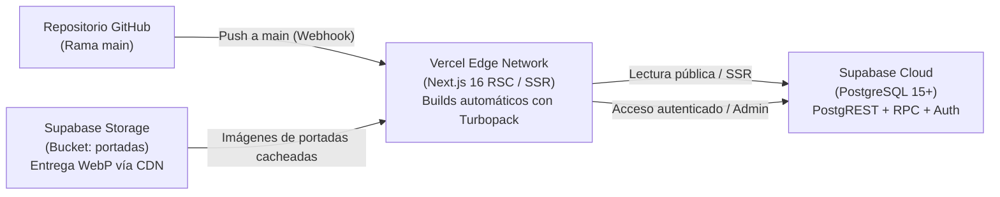

# 05 · Guía de Despliegue, Infraestructura en la Nube y Operaciones

> **Propósito:** Documentar el procedimiento de despliegue continuo en Vercel, la infraestructura de datos en Supabase Cloud, la política de respaldos y el plan de contingencia ante caídas de servicio.
> **Responde a:**
> - ¿Cómo se despliega la aplicación en Vercel y qué variables de entorno exactas requiere en producción?
> - ¿Cómo se gestionan las migraciones y la integridad de datos en el entorno de producción de Supabase?
> - ¿Cuál es la política de respaldo periódico de metadatos y arte gráfico?
> - ¿Cómo se ejecuta una reversión rápida (rollback) si un despliegue presenta errores críticos?
> **Fuente principal de:** Pipeline de CI/CD en Vercel, variables de entorno de producción, monitoreo y protocolo de recuperación ante desastres.
> **No contiene (ver):**
> - Instalación y configuración en máquina local → [instalacion-y-entorno.md](file:///c:/Users/CACTU/Downloads/Proyectos/cumbia-peruana/docs/05-entorno-y-operacion/instalacion-y-entorno.md)
> - Reglas de control de versiones y ramas de Git → [git.md](file:///c:/Users/CACTU/Downloads/Proyectos/cumbia-peruana/docs/07-gestion/git.md)
> - Políticas de seguridad RLS y permisos → [seguridad-y-datos.md](file:///c:/Users/CACTU/Downloads/Proyectos/cumbia-peruana/docs/06-calidad/seguridad-y-datos.md)
> **Depende de:**
> - [instalacion-y-entorno.md](file:///c:/Users/CACTU/Downloads/Proyectos/cumbia-peruana/docs/05-entorno-y-operacion/instalacion-y-entorno.md)
> - [arquitectura.md](file:///c:/Users/CACTU/Downloads/Proyectos/cumbia-peruana/docs/03-arquitectura/arquitectura.md)
> **Entregar a otra IA para:** Configurar pipelines de GitHub Actions, diagnosticar errores de despliegue en Vercel o auditar costos de infraestructura en la nube.
> **Estado:** VIGENTE · **Última revisión:** 2026-10-31 · **Describe la versión:** commit 04ef58c

---

## 1. Arquitectura de Infraestructura en la Nube



---

## 2. Variables de Entorno en Producción (Vercel)

En el panel de configuración de Vercel (*Project Settings -> Environment Variables*), únicamente se requieren dos variables de entorno para los entornos de **Production** y **Preview**:

| Variable de Producción | Entornos | Valor Requerido | Propósito |
| :--- | :--- | :--- | :--- |
| `NEXT_PUBLIC_SUPABASE_URL` | Production, Preview | `https://<project-ref>.supabase.co` | Endpoint raíz de la API de Supabase. |
| `NEXT_PUBLIC_SUPABASE_ANON_KEY` | Production, Preview | `eyJhbGciOiJIUzI1NiIsIn...` | Token anónimo público con permisos controlados por RLS. |

> [!NOTE]
> La variable `SUPABASE_ACCESS_TOKEN` **NO** se configura en Vercel. Solo se utiliza en la máquina local del administrador para ejecutar el script de catalogación e ingesta `npm run db:poblar`.

---

## 3. Proceso de Publicación Paso a Paso

1. **Verificación Previa Local:**
   Antes de enviar cambios al repositorio remoto, se deben superar las verificaciones de tipado estricto y linting:
   ```bash
   npx tsc --noEmit
   npm run lint
   npm run build
   ```
2. **Envío de Cambios a la Rama Principal:**
   ```bash
   git add .
   git commit -m "feat(vinilos): registrar nuevo prensaje de Grupo Celeste"
   git push origin main
   ```
3. **Compilación Automática en Vercel:**
   - Vercel detecta el commit mediante el webhook de GitHub.
   - Ejecuta `npm install` y `npm run build` con Turbopack.
   - Si la compilación es exitosa, promueve automáticamente el despliegue a producción en la URL canónica del proyecto en menos de 45 segundos.

---

## 4. Procedimiento de Reversión Inmediata (Rollback)

Si un despliegue en producción introduce un error no detectado en las pruebas:

1. Ingrese al panel de Vercel del proyecto (*Deployments*).
2. Localice el último despliegue estable previo en la lista histórica.
3. Haga clic en el menú contextual de tres puntos (`...`) del despliegue anterior y seleccione **Instant Rollback**.
4. Vercel redirigirá el tráfico del dominio principal a la versión anterior de forma inmediata (en menos de 5 segundos) sin necesidad de recompilar.

---

## 5. Política de Respaldo de Base de Datos y Restauración

| Tipo de Recurso | Frecuencia de Respaldo | Ubicación del Respaldo | Método de Restauración |
| :--- | :--- | :--- | :--- |
| **Metadatos y Tablas SQL** | Diaria automática (Supabase Cloud) + Semanal manual | Supabase Backup Vault + Volcados locales `supabase/seed.sql` | Vía Supabase Dashboard (*Settings -> Backups -> Restore*) o comando `npm run db:poblar -- --reset`. |
| **Arte Gráfico (Portadas WebP)** | Replicación distribuida continua | S3 Storage Bucket redundante en Supabase | Re-sincronización de carpetas de almacenamiento mediante Supabase CLI. |
| **Código y Migraciones DDL** | Inmutable por cada commit | Repositorio Git en GitHub | Clonado y despliegue del commit deseado. |

---

## 6. Monitoreo, Registros y Presupuesto de Costos

- **Monitoreo de Rendimiento:** Vercel Analytics y Web Vitals configurados en el proyecto para auditar LCP, FID y CLS.
- **Registros de Errores (Logging):** Disponibles en tiempo real en la pestaña *Runtime Logs* de Vercel para capturar excepciones en Server Components o llamadas PostgREST.
- **Presupuesto y Costos Recurrentes:**
  - Vercel: Plan Hobby / Free Tier ($0/mes).
  - Supabase: Plan Free Tier con cuota de hasta 500 MB de base de datos y 1 GB de almacenamiento ($0/mes).
  - Costo total recurrente operativo: **$0.00 USD/mes**.

---

## 7. Actualizar Cuando

- Cambie el proveedor de hosting o la configuración del dominio DNS.
- Se agregue una nueva variable de entorno requerida en tiempo de ejecución.
- Se modifique la política de copias de seguridad de Supabase.
