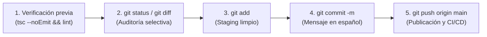

# 07 · Flujo de Trabajo Git, Ramas y Convención de Commits

> **Propósito:** Definir el ciclo de trabajo con Git, las reglas de branching, la convención de mensajes en español y las prohibiciones estrictas para colaboradores y agentes de IA en Kumbia Sound.
> **Responde a:**
> - ¿Cuál es el ciclo obligatorio de trabajo antes de confirmar y publicar cambios?
> - ¿Qué convención de Conventional Commits en español rige el repositorio?
> - ¿Cómo se organizan las ramas y qué políticas de protección aplican a `main`?
> - ¿Qué archivos y secretos está terminantemente prohibido incluir en el staging de Git?
> **Fuente principal de:** Reglas de versionado Git, formato de mensajes de commit, política de ramas y sincronización con documentación viva.
> **No contiene (ver):**
> - Puerta de verificación de calidad y pruebas → [pruebas.md](file:///c:/Users/CACTU/Downloads/Proyectos/cumbia-peruana/docs/06-calidad/pruebas.md)
> - Historial de versiones y lanzamientos → [changelog.md](file:///c:/Users/CACTU/Downloads/Proyectos/cumbia-peruana/docs/07-gestion/changelog.md)
> - Reglas operativas para agentes de IA → [AGENTS.md](file:///c:/Users/CACTU/Downloads/Proyectos/cumbia-peruana/AGENTS.md)
> **Depende de:**
> - [instalacion-y-entorno.md](file:///c:/Users/CACTU/Downloads/Proyectos/cumbia-peruana/docs/05-entorno-y-operacion/instalacion-y-entorno.md)
> - [pruebas.md](file:///c:/Users/CACTU/Downloads/Proyectos/cumbia-peruana/docs/06-calidad/pruebas.md)
> **Entregar a otra IA para:** Configurar hooks de pre-commit (Husky/Lint-staged), auditar el historial de commits o automatizar releases semánticos.
> **Estado:** VIGENTE · **Última revisión:** 2026-10-31 · **Describe la versión:** commit 04ef58c

---

## 1. Ciclo de Trabajo Obligatorio

En este proyecto, cada modificación completada debe cerrarse de inmediato siguiendo este ciclo continuo:



### 1.1 Pasos Operativos
1. **Verificación previa:** Asegurar que el código pasa el gate de calidad sin errores:
   ```bash
   npx tsc --noEmit
   npm run lint
   npm run build
   ```
2. **Auditoría selectiva:** Inspeccionar minuciosamente los cambios antes de añadirlos:
   ```bash
   git status
   git diff
   ```
3. **Staging selectivo:** Agregar únicamente los archivos correspondientes a la tarea:
   ```bash
   git add <archivo1> <archivo2>
   ```
4. **Commit con mensaje convencional en español:**
   ```bash
   git commit -m "<tipo>(<alcance>): <descripción concisa>"
   ```
5. **Push remoto inmediato:**
   ```bash
   git push origin main
   ```

---

## 2. Convención de Mensajes de Commit (Conventional Commits)

Todos los mensajes deben redactarse en **español**, en modo indicativo presente o infinitivo, y sin punto final en la primera línea.

### 2.1 Tipos Permitidos

| Prefijo | Cuándo Usarlo | Ejemplo Práctico |
| :--- | :--- | :--- |
| **`feat:`** | Nueva característica, pantalla, procedimiento o módulo. | `feat(camelot): incorporar filtro por radio de pitch en consola DJ` |
| **`fix:`** | Corrección de un fallo funcional, cálculo o error visual. | `fix(vinilos): corregir cálculo de duración en pistas de Lado B` |
| **`docs:`** | Creación o actualización de documentación en `docs/`. | `docs(arquitectura): consolidar ADR-001 a ADR-005 en sistema v1.0` |
| **`refactor:`** | Modificación interna del código sin añadir features ni bugs. | `refactor(rsc): paralelizar consultas de cabecera con Promise.all` |
| **`style:`** | Ajustes visuales, CSS o Tailwind sin cambios lógicos. | `style(brutalism): ajustar sombra rígida de tarjetas en vista móvil` |
| **`test:`** | Adición o corrección de pruebas automatizadas o guiones. | `test(genealogia): agregar guion de verificación de árbol de versiones` |
| **`chore:`** | Tareas auxiliares, dependencias, scripts o configuración. | `chore: actualizar dependencias y limpiar directorios obsoletos` |

---

## 3. Política de Ramas y Protección

- **Rama Principal (`main`):** Es la fuente de verdad de producción conectada a Vercel. Cada push a `main` desencadena un despliegue inmediato.
- **Ramas de Trabajo Temáticas (`feat/...`, `fix/...`):** Utilizadas para desarrollos extensos que requieran revisión antes de integrarse a `main`.
- **Prohibiciones Absolutas:**
  - Queda prohibido el uso de `git push --force` o `git reset --hard` sobre ramas remotas compartidas.
  - Queda prohibido commitear archivos de variables de entorno (`.env`, `.env.local`), carpetas de dependencias (`node_modules/`), artefactos de build (`.next/`) o volcados de tokens (`.temp/`).

---

## 4. Documentación Viva en el Mismo Commit

Si un cambio de código altera la firma de una función, la estructura de una tabla, el comportamiento de una pantalla o agrega una nueva regla de negocio, el archivo de documentación correspondiente en `docs/` **debe modificarse y confirmarse en el mismo commit** (o en un commit `docs:` inmediatamente posterior) para evitar desfasajes.

---

## 5. Actualizar Cuando

- Se modifique la estrategia de ramas o protección del repositorio en GitHub.
- Se introduzca una nueva herramienta de control de versiones o hooks pre-commit.
- Se actualice la convención de prefijos o alcances permitidos.
