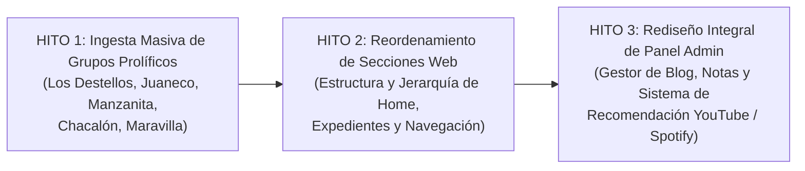

# 07 · Hoja de Ruta (Roadmap) y Prioridades Estratégicas

> **Propósito:** Planificar el trabajo futuro, registrar los hitos prioritarios confirmados por el propietario y mantener el backlog técnico del archivo fonográfico Kumbia Sound.
> **Responde a:**
> - ¿Cuáles son los próximos hitos de desarrollo y en qué orden se abordarán?
> - ¿Qué tareas se encuentran actualmente en curso y cuáles en el backlog?
> - ¿Qué ideas han sido descartadas formalmente y por qué motivos?
> - ¿Cómo se vinculan los hitos con los requisitos funcionales (`RF-NNN`) y decisiones (`DEC-NNN`)?
> **Fuente principal de:** Hitos prioritarios, backlog clasificado y estado de avance estratégico del proyecto.
> **No contiene (ver):**
> - Historial de cambios pasados ya implementados → [changelog.md](file:///c:/Users/CACTU/Downloads/Proyectos/cumbia-peruana/docs/07-gestion/changelog.md)
> - Registro de deudas técnicas y riesgos abiertos → [problemas-conocidos.md](file:///c:/Users/CACTU/Downloads/Proyectos/cumbia-peruana/docs/07-gestion/problemas-conocidos.md)
> - Requisitos funcionales detallados → [requisitos.md](file:///c:/Users/CACTU/Downloads/Proyectos/cumbia-peruana/docs/02-requisitos/requisitos.md)
> **Depende de:**
> - [requisitos.md](file:///c:/Users/CACTU/Downloads/Proyectos/cumbia-peruana/docs/02-requisitos/requisitos.md)
> - [decisiones.md](file:///c:/Users/CACTU/Downloads/Proyectos/cumbia-peruana/docs/03-arquitectura/decisiones.md)
> **Entregar a otra IA para:** Planificar sprints de trabajo, estimar esfuerzo de nuevas características o descomponer hitos en tareas atómicas.
> **Estado:** VIGENTE · **Última revisión:** 2026-10-31 · **Describe la versión:** commit 04ef58c

---

## 1. Hitos Prioritarios Confirmados por el Propietario

El plan de evolución del proyecto se estructura en tres hitos prioritarios flexibles (certeza operativa del 70 %, sujetos a refinamientos incrementales):

---

## 2. Tabla de Seguimiento del Roadmap

| ID | Ítem / Característica | Descripción | Prioridad | Estado Decisión | Estado Impl. | Requisitos / Decisiones |
| :--- | :--- | :--- | :--- | :--- | :--- | :--- |
| **`ROAD-01`** | **Ingesta de Grupos Prolíficos** | Ingestión masiva de discografías completas (LPs, singles 45, matrices y sesionistas) de Los Destellos, Juaneco y su Combo, Manzanita, etc. | Alta (Hito 1) | `CONFIRMADA` | `EN CURSO` | `RF-001`, `RF-008`, `INV-001` a `INV-010` |
| **`ROAD-02`** | **Reordenamiento de Secciones Web** | Reestructuración de la portada (`/`) y catálogo (`/vinilos`) para una jerarquía más intuitiva de expedientes documentales y navegación. | Alta (Hito 2) | `CONFIRMADA` | `PENDIENTE` | `RF-001`, `pantallas.md` |
| **`ROAD-03`** | **Rediseño del Panel Admin** | Interfaz optimizada y cómoda para que el propietario gestione blogs, notas históricas y expedientes sin tocar SQL. | Alta (Hito 3) | `CONFIRMADA` | `PENDIENTE` | `RF-006`, `RF-009`, `UC-004` |
| **`ROAD-04`** | **Módulo de Recomendaciones** | Sistema curatorial mensual vinculado al canal de YouTube y playlists oficiales de Spotify del autor para destacar temas y grupos. | Media (Hito 3) | `CONFIRMADA` | `PENDIENTE` | `RF-010`, `DEC-006` |
| **`ROAD-05`** | **Suite de Pruebas Unitarias** | Implementación de pruebas automáticas con Vitest para Rueda Camelot y compatibilidad armónica. | Baja (Calidad) | `PROPUESTA` | `NO IMPLEMENTADO` | `TD-001`, `pruebas.md` |
| **`ROAD-06`** | **Expansión a Cumbia Colombiana**| Incorporación de grabaciones históricas de cumbia colombiana en un archivo complementario. | Futuro | `PROPUESTA` | `NO IMPLEMENTADO` | Alcance post-2026 |

---

## 3. Ítems Descartados Formalmente

| Ítem Descartado | Razón del Descarte | Enlace a Decisión |
| :--- | :--- | :--- |
| **Streaming de Audio MP3/WAV en Servidor** | Vulneración de derechos de autor y altos costos de ancho de banda. Se prioriza archivo de metadatos técnicos. | [DEC-006](file:///c:/Users/CACTU/Downloads/Proyectos/cumbia-peruana/docs/03-arquitectura/decisiones.md#dec-006) |
| **Soporte de Lados C y D en Vinilos** | Inexistencia histórica de vinilos dobles de cumbia peruana en el período 1968–2005. | [DEC-001](file:///c:/Users/CACTU/Downloads/Proyectos/cumbia-peruana/docs/03-arquitectura/decisiones.md#dec-001) |
| **Microservicio Docker de Compresión** | Resuelto de forma óptima y sin coste en el cliente con HTML5 Canvas API. | [DEC-004](file:///c:/Users/CACTU/Downloads/Proyectos/cumbia-peruana/docs/03-arquitectura/decisiones.md#dec-004), [DEC-007](file:///c:/Users/CACTU/Downloads/Proyectos/cumbia-peruana/docs/03-arquitectura/decisiones.md#dec-007) |

---

## 4. Actualizar Cuando

- Se concluya o inicie un hito prioritario de desarrollo.
- El propietario apruebe nuevas prioridades o cambie el orden de ejecución.
- Se descarte o aplace una característica planificada.
